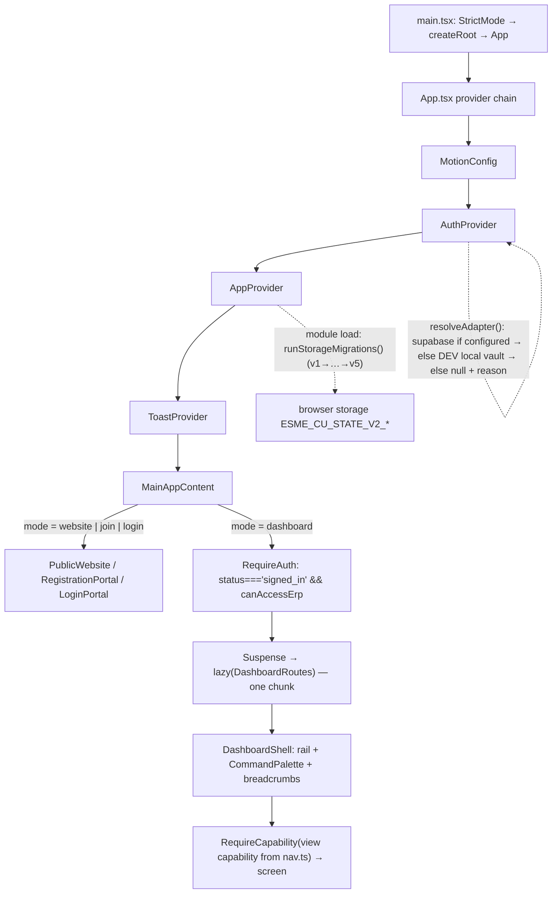

# ESME CU Platform — Project Master Guide

**Generated:** 2026-10-19, during the engineering audit that ran `npm test`, `npx tsc -b --force`,
`npx oxlint .` and `npm run build` against this tree.
**Codebase root:** `esme-cu-platform/` (the git repository root is the parent folder, which also
holds the chapter's source material — spec PDFs, extracted images, `Assets/`).
**Rule of this document:** every claim is either a file reference, a command that exists here, or an
observed result. Anything not verified is labelled `NOT VERIFIED`, `BLOCKED` or `PARTIALLY VERIFIED`.
Deep detail lives in `docs/` and `supabase/README.md`; this file summarizes and links, it does not
duplicate.

---

## 1. Executive summary

ESME CU is a single Vite/React application that serves two surfaces: the chapter's public website
and the members' ERP behind a real sign-in. There is **no backend process in this repository** —
the intended server is a Supabase project (Postgres + RLS + GoTrue + Edge Functions), and the app
currently runs its operational data through versioned browser storage with a framework-free domain
layer mirroring the SQL rules.

What is genuinely finished: the public site, the registration flow, the whole capability model, 22
routed dashboard screens, the content/media CMS, the reward and discipline rules, the email template pair,
and 728 automated tests across 48 files that all pass alongside a clean typecheck, a clean lint
(14 pre-existing warnings, 0 errors) and a successful production build. As of 2026-10-22 the reward
ledger's **writes** go through the provider contract rather than browser storage — see §5 and §17.

What is **not** finished is server-side reality: migrations `0001`–`0008` have never been applied to
any project, so no Supabase sign-in can succeed and none of the SQL — 77 function definitions and 29
triggers, 48 policies over 25 tables, the email queue, the reward RPCs — has ever been parsed by
Postgres. The
remote project that the environment now points at answers `PGRST202` for the first RPC the app calls,
which is the schema saying "I do not have that function" — including the four reward RPCs, which is
why every reward write against that project currently fails closed with `schema_missing`. Everything
in this guide that concerns the database is therefore **authored and statically checked, not
executed**.

Two real defects were found and fixed during this audit, both with root causes rather than patches:
a policy in `0002` that Postgres cannot parse (which would have aborted that file and everything
downstream), and an environment leak that turned a filled `.env.local` into 100+ unrelated test
failures. Full detail in §2 and §17.

### Readiness by category

| # | Category | Status | Why |
| --- | --- | --- | --- |
| 1 | Source code | **VERIFIED** (as compiled code) | `tsc -b --force` exit 0; `oxlint` 0 errors; `vite build` succeeded. Does not certify behaviour. |
| 2 | Automated tests | **VERIFIED** | 48 files / 728 tests passed on this tree (2026-10-22, 36.52s, exit 0), re-run after every fix. Covers client rules and surfaces — including the provider contract against **stubbed** adapters — not the server. |
| 3 | Authentication & registration | **PARTIALLY VERIFIED** | Registration, status gating, lockout and the local vault are tested. A real provider sign-in has never completed — see #4. |
| 4 | Database migrations | **BLOCKED** | 0001–0011 exist and are internally consistent; none has ever been applied. The apply path is now scripted ([scripts/apply-migrations.mjs](scripts/apply-migrations.mjs), 21 tests) and still needs `SUPABASE_DB_URL`, a named staging project and explicit approval. |
| 5 | RLS & security | **PARTIALLY VERIFIED** | Policy/guard design reviewed, the parse-breaking policy fixed, static invariants added and proved non-vacuous, the five findings below closed forward (0009 for the column and the views, 0010 for the two RPCs), the escalation paths now covered by 17 store/adapter regression cases that were each proved to fail when their guard was deleted, and the refusal paths have probe blocks P00–P23. No policy has been exercised against Postgres; the probe file has never run. |
| 6 | Staging deployment | **NOT VERIFIED** | A project exists and `.env.local` points at it, but its schema is empty and no migration, seed or probe has been run against it. Nothing is deployed. |
| 7 | Production deployment | **BLOCKED** | Build output is deployable; the app is not usable until migrations are applied and the Edge Function + secrets are provisioned. |
| 8 | Backup & recovery | **NOT VERIFIED** | Procedures are written (`supabase/README.md` → Backup and restore) and the app's JSON export is understood, but no `pg_dump`/restore cycle has been performed — there is no database to dump. |
| 9 | Documentation | **VERIFIED** (this tree) | 8 files in `docs/`, `supabase/README.md`, root `README.md`, plus this guide. Every claim keeps its evidence label; nothing here asserts a database behaviour that was not observed. |

### The five levels a claim has to pass

The table above answers "how ready is this category?". This one answers the sharper question the
2026-10-22 database gate asks of every feature: *what is the furthest level the evidence actually
reaches?* A row is only as strong as its rightmost filled column, and `never` means the environment
here has no PostgreSQL, Docker or Supabase CLI to test against (§13 gate 2), not that somebody tried
and it failed. Reading one column as another is exactly the failure this table exists to prevent —
"the SQL is written" is not "the SQL runs", and "the tests are green" is not "the policy refused".

| Area | 1. In code | 2. Automated tests | 3. Real PostgreSQL | 4. Real Supabase staging | 5. Production-ready |
| --- | --- | --- | --- | --- | --- |
| Migrations 0001–0011 | yes | static invariants only (`migrationIntegrity.test.ts`, 18 cases) | never | never | no |
| Migration apply path (`scripts/apply-migrations.mjs`) | yes | yes — 21 cases, plan/abort/project gate | never (no `psql` binary here) | never | no |
| Authorization probes `P00–P23` | yes | n/a (they are the staging test) | never | never | no |
| Role-escalation guardrails (store + dev adapter) | yes | yes — `src/context/privilegeEscalation.test.tsx`, 17 cases, three guards mutation-checked | n/a (client layer) | never | no |
| `esme_assign_role()` / `esme_set_account_status()` rules | yes | static text only (0010); `ESME_SELF_ROLE_CHANGE`, the `p_role <> 'member'` privilege test, both values in the audit detail | never | never | no |
| RLS policies, grants, guards | yes | parse/shape checks only | never | never | no |
| Sign-in, identity, capabilities | yes | yes, against a **stubbed** adapter | never | never | no |
| Registration queue read/decide | yes | yes, stubbed | never | never | no |
| Reward **writes** (bonus, warning, reversal, acknowledge) | yes | yes, stubbed | never | never | no |
| Reward **reads** and the policy matrix | yes — RPCs exist, adapter does not call them | no | never | never | no |
| Tasks, submissions, scores, skill matrix | yes, local store | yes, local store | never | never | no |
| Committees, leadership seats | yes, local store + server RPCs | yes, local store | never | never | no |
| Notifications, audit trail | yes, local store | yes, local store | never | never | no |
| Email outbox + `send-email` Edge Function | yes | outbox logic only | never | never (no deploy, no secrets) | no |
| First-administrator bootstrap | yes | refusal path only | never | never | no |
| Test-account seeding | yes | refusal path only | never | never | no |
| Backup / restore drill | procedure written | no | never | never | no |
| CI workflow (`.github/workflows/ci.yml`) | authored | n/a | never run on a host | never | no |
| The five SQL findings in §2 ("Confirmed now", 2026-10-22 gate) | **fixed forward**: 0009 for findings 1–2 (privilege-column guard + `security_invoker` views with their grants), 0010 for 7–9 (the two role RPCs) | static invariants only (three of the 13 `migrationIntegrity` cases cover 0009's guard/shape and 0010's rules) | never | never | no |

**Column 3 and column 4 are empty for every row without exception.** No migration, probe, RPC,
policy, view or trigger in this repository has been executed against any database. Until that
happens in a staging project, no row can enter column 5, and the go/no-go in §16 stays **NO-GO**.


---

## 2. Project history and known findings

Commit history (`git log --oneline`): `69d4e50 Update project`, `30f8080 checkpoint: preserve
verified motion system before ERP/auth work`, `60f589c Initial commit`. The working tree carries a
large amount of uncommitted work (126 changed/untracked paths at the time of writing) — **this
repository has no feature-branch discipline and nothing is committed by the agent without explicit
authorization**.

### Historical findings — no longer true, do not re-report

| Claim | Current state | Evidence |
| --- | --- | --- |
| "114 failures, 491 passes of 605" | Not reproducible. 42 files / 611 tests pass. | `npx vitest run` on this tree. |
| "Dashboard tests render only the toast container" | Resolved. The cause was auth, not rendering: the Gate waits for `status === 'signed_in'`, and the tests were resolving the *real* provider from a filled `.env.local` and never signing in. | [src/context/rewards.test.tsx:100](src/context/rewards.test.tsx) Gate/Probe; [vite.config.ts:16](vite.config.ts). |
| "`emailTriggers`, `operationalCache`, `rewards`, `websiteContent` report `the store has not rendered yet`" | Same single cause; fixed by pinning the test environment, not by touching any test. | `npx vitest run` green. |
| "Registration tests fail to save an application / show `Application received.`" | Pass. | `npx vitest run src/components/RegistrationPortal.test.tsx` → 5 passed, including the assertion at [src/components/RegistrationPortal.test.tsx:127](src/components/RegistrationPortal.test.tsx). |
| "`isSupabaseConfigured()` returned true when the test expected false" / "`readEmailPreferences()` returned null instead of rejecting" | Both are env-leak symptoms and are gone. `isSupabaseConfigured()` *deliberately* stays a presence check; the malformed-value cases now raise `AuthMisconfiguredError`. | [src/auth/supabaseAdapter.ts:54](src/auth/supabaseAdapter.ts), `src/auth/auth.test.ts` `provider resolution`. |
| "`public.esme_profiles` / `public.esme_settings` missing on Production" | Still true — and still expected: migrations were never applied. It is not a schema bug. | `PGRST202` on `esme_needs_primary_admin`. |

### Confirmed now (found and fixed in this audit)

1. **P0 — `0002_functions_rls.sql` could not be applied.** `esme_pages_update` carried a
   `with check` expression referencing `OLD.published`. A policy expression has no `old`/`new`
   pseudo-record — that is trigger-only syntax — so Postgres raises
   `column "old" does not exist` while parsing. Because each migration file is wrapped in a single
   `begin; … commit;`, that abort discards **all** of 0002 and therefore blocks 0003–0008 as well.
   Fixed by moving the rule where both row versions exist: a `before insert or update` guard trigger
   `esme_assert_publication_write()`, with the policy reduced to `cms.content.write`. Design and
   residual risk: [docs/DATABASE_AND_MIGRATIONS.md](docs/DATABASE_AND_MIGRATIONS.md) → "Why the
   publication rule is a trigger, not a policy"; probes: `supabase/README.md` checklist lines 42–45.
2. **P0 — test results depended on the developer's `.env.local`.** Vite loads `.env.local` for Vitest
   too, so `VITE_SUPABASE_URL`/`VITE_SUPABASE_ANON_KEY` reached `import.meta.env`,
   `resolveAdapter()` picked the real provider, and every store/screen test waited on a network call
   behind the auth Gate. Fixed with a `test.env` pin in [vite.config.ts](vite.config.ts) — the tests
   are unchanged and no assertion was weakened. This is exactly the 114-failure report's mechanism.
3. **P1 — a misconfigured provider looked like a bad password.** A `/rest/v1/` suffix pasted into
   `VITE_SUPABASE_URL` (observed in a real `.env.local`) or a secret key pasted into the public
   variable produced confusing failures. Now refused up front with messages that never quote the
   value; the rejected client promise is also no longer memoized, so fixing the environment does not
   require a reload. [src/auth/supabaseAdapter.ts:40-100](src/auth/supabaseAdapter.ts).
4. **P2 — timeouts were the flake class, and the fix is now run-wide.** PBKDF2 (210,000 iterations,
   SHA-256) runs once per sign-in, the screen suites sign in in `beforeEach`, and Vitest spawns one
   isolated worker per file. `CommitteeManagement` and `ModeratorTools` were first given individual
   budgets (20s, 25s + `asyncUtilTimeout: 12_000`); the final verification run then lost one case each
   in `RewardsAndDiscipline`, `TaskCommandCenter` and `WebsiteCMS` at 5.9–6.1s on the same tree that
   had been green minutes earlier. The budget moved to `testTimeout: 15_000` in
   [vite.config.ts](vite.config.ts) — no assertion, wait or `asyncUtilTimeout` was changed, so a
   missing control still fails at 1000ms and a real hang still fails, later. Green twice after that.
5. **P2 — documentation drift.** The root `README.md` still described `pending_email_verification`
   as a live account state and claimed "no project or keys exist". Corrected; PBKDF2-SHA256 was
   verified against the code before restating it.

### Confirmed now (2026-10-22 database gate) — found by line-by-line review

Every line below is static review of SQL text. None of it was executed: this environment has no
`psql`, `postgres`, Docker or Supabase CLI, so the severity is what the reading implies, and probe
`P15`–`P21` are what turn "expected" into "observed" on staging. Nothing here was patched in
place — the rule (§15) is a new forward migration, never an edit to a migration that may already be
applied somewhere else. **Findings 1 and 2 now have that migration**
([`0009_security_hardening.sql`](supabase/migrations/0009_security_hardening.sql)); findings 3–6 are
documentation or owner-decision items and are not in it. The same review left three more differences
open one level up — inside the role RPCs 0009 had no reason to touch — and those are the next table.

| # | Sev | Finding | Evidence | What closes it |
| --- | --- | --- | --- | --- |
| 1 | **Critical** | A role can be granted by writing `esme_profiles.role` directly. `esme_profiles_update`'s `with check` accepts any new column values whenever `esme_reaches_profile(id,'users.update')` holds, and the `committee` scope includes the caller's own row — so a Head or Director can `PATCH /rest/v1/esme_profiles` on themselves to `super_admin`. 0004's channel guards freeze `committee_id` and the two seat columns, never `role`; no trigger guards it; the "Server-side only" note on the column is a comment, not a rule. | [0002_functions_rls.sql:833-849](supabase/migrations/0002_functions_rls.sql), `esme_profiles_home_channel` at [0004:205-220](supabase/migrations/0004_committee_leadership.sql), the only role write path at [0002:646-681](supabase/migrations/0002_functions_rls.sql) | **Closed in code** by 0009's `esme_assert_privilege_channel()` — a `before insert or update` channel guard on `role` **and** `status`, reusing `esme_called_directly()`, so `esme_assign_role()` / `esme_decide_registration()` / `esme_set_account_status()` and the 0003/0008 paths keep working while a direct `PATCH` raises `ESME_ROLE_FUNCTION_ONLY`. Probe `P15` must print PASS after the apply and FAIL on a project that stops at 0008; until either runs, this row is `[static review + automated static tests]`, not `[verified against Postgres]`. |
| 2 | **High** | Three granted views bypass RLS. `esme_member_scores`, `esme_committee_rosters` and `esme_member_reward_records` are ordinary views granted `select` to `authenticated`; Postgres reads their base tables as the view owner, and `security_invoker` appears **nowhere** in any migration — while [0002:1047](supabase/migrations/0002_functions_rls.sql) claims "Views run with the caller's rights, so RLS above already applies". Any signed-in Member can therefore read every member's total points and approved-task count, and the reward view can leak rows the `rewards.read` scope was written to withhold. | [0001:301-319](supabase/migrations/0001_schema.sql), [0002:1047-1048](supabase/migrations/0002_functions_rls.sql), [0006:192](supabase/migrations/0006_rewards_discipline.sql), [0006:970-971](supabase/migrations/0006_rewards_discipline.sql); `grep -c security_invoker supabase/migrations/*.sql` was 0 in all eight files as written | **Closed in code** by 0009, which does three things at once rather than one: `alter view … set (security_invoker = true)` on all three, `grant select` to `authenticated` on the five base relations they compose (an invoker view without those grants **raises** `42501` instead of filtering — a permission error is not an access control), and `revoke … from anon, public` on the views plus the tables the public site has no reason to read. Probes `P16` (count matches the caller's own policy), `P18` (the reward view returns only the caller's row) and `P19` (roster count still equals the committees the scope reaches, so the narrowing did not overreach). Frontend reads of these views still do not exist, so the leak was always a hand-made REST call — and 0009 does not change that any *client* now consults them. `[static review + automated static tests]` until P16/P18/P19 run. |
| 3 | **Medium** | `0001_schema.sql`'s header told the operator to apply the schema with `supabase db push`, the one path §13 forbids (it cannot be pinned to a named project and may wrap a file in one transaction, which 0006's enum step does not survive). Corrected to the scripted runner; comment-only change, no SQL touched. | header line 3 of [0001_schema.sql](supabase/migrations/0001_schema.sql); the prohibition at §13 and [docs/PRODUCTION_READINESS.md](docs/PRODUCTION_READINESS.md) | Done. Re-check that no other doc recommends `db push`. |
| 4 | **Medium** | `FORCE ROW LEVEL SECURITY` is set on the three email tables and on nothing else — and no `insert` policy exists for `esme_email_outbox`. Whether `esme_queue_email()` (SECURITY DEFINER, running as the table owner) can still queue a decision mail depends on role attributes this environment cannot inspect, so every approval/rejection email is unproven, not merely untested. | [0005:784-812](supabase/migrations/0005_email_notifications.sql), `esme_queue_email` at [0005:203-227](supabase/migrations/0005_email_notifications.sql) | Probe: `P17`. If it fails, the fix is an explicit policy for the owner/service path — decided from the observed error, not guessed now. |
| 5 | **Low** | The primary administrator is identified by a credential literal baked into SQL: `esme_is_primary_admin()` matches `email = 'kareemeltemsah7@gmail.com' or username = 'temsah1'`. Changing that mailbox, or running a second chapter on this schema, silently loses the protection. | [0002:226-239](supabase/migrations/0002_functions_rls.sql) | Move the protected identity into an `esme_settings` row read by the function. Needs an owner decision about which account is primary, so it is not folded into a fix-up migration. |
| 6 | **Low** | The capability matrix for one role is split across two files (`0002` seeds five roles, `0006` adds `high_board` and every `rewards.*` row) and 0001 still defaults `status` to the value 0007 later makes unreachable. Both are internally consistent and the integrity test proves the vocabulary matches `src/domain/roles.ts` in both directions, but a reviewer reading one file alone will mis-read the rules. | [0002:12-103](supabase/migrations/0002_functions_rls.sql), [0006:70-95](supabase/migrations/0006_rewards_discipline.sql), [0001:56](supabase/migrations/0001_schema.sql) vs [0007:45-57](supabase/migrations/0007_remove_email_verification.sql) | Documentation only: each file now points at the other. No schema change is justified. |

### The three the column guard could not reach — closed forward by 0010

0009 froze the column; the role still moves through `esme_assign_role()`, and that function is where the
remaining differences between the claimed rule and the enforced one lived. Same method as above: static
reading of SQL text, nothing executed.

| # | Sev | Finding | Evidence | What closes it |
| --- | --- | --- | --- | --- |
| 7 | **Medium today, Critical with the IT grant** | An account could change its own role. `esme_assign_role()` checks the caller holds `users.role.assign` and never compares `p_user_id` with the caller; the only self-shaped rule is `ESME_SELF_LOCKOUT` inside `esme_set_account_status()`, so the asymmetry is a gap, not a decision. Reachable today only as a Super Admin moving their own row — 0002's primary-admin clause even let the primary account re-write `super_admin` onto itself (`p_role <> 'super_admin' or p_user_id <> v_actor.id`), so the lockout path is real, and the moment a second role is granted `users.role.assign` the same line becomes self-promotion that 0002 would audit as a routine grant. `validateRoleChange()` already refuses a self-target for every role, so the client was stricter than the server. | [0002:646-681](supabase/migrations/0002_functions_rls.sql), the primary clause at [0002:666](supabase/migrations/0002_functions_rls.sql) vs the status rule at [0002:626-628](supabase/migrations/0002_functions_rls.sql); [src/domain/roles.ts:252-266](src/domain/roles.ts) | **Closed in code** by 0010's restated `esme_assign_role()`: `ESME_SELF_ROLE_CHANGE` raised after the capability check (so the member still gets the cheap, specific answer) and before the write, and the primary-admin clause made unconditional so that account's role is immovable from both directions. Probe `P20` attempts the self-target as a Super Admin, and — the part that matters — re-reads the row afterwards, because a refusal that half-wrote it is worse than no guard. `[static review + automated static tests]` until P20 runs; the client half is `[verified by automated tests]` (`src/context/privilegeEscalation.test.tsx` §7.1, with the domain rule mutation-checked). |
| 8 | **Low today, same dependency** | The privileged-role list in SQL is stale. `v_privileged := p_role in ('super_admin','director','head','moderator')` predates 0006's `high_board` label and was never revisited, so a grantee below Super Admin could hand out a chapter-wide read role while the identical grant of IT Moderator was refused — and the comment above the function claims "same rules, checked where they actually bind". `PRIVILEGED_ROLES` in the domain lists five labels including `high_board`. | [0002:670-672](supabase/migrations/0002_functions_rls.sql) vs [src/domain/roles.ts:65](src/domain/roles.ts); [0006:33](supabase/migrations/0006_rewards_discipline.sql) added the label | **Closed in code** by 0010 inverting the test — `if p_role <> 'member' and v_actor.role <> 'super_admin'` — so every label except the default is a privileged grant, and a role added by a future migration is covered the day it exists instead of waiting for somebody to remember a list. A non-Super-Admin grantee can still demote to `member`. `[static review]` only: no probe needs a second grantee, so nothing here is observed until a project has a role that holds `users.role.assign` and is not `super_admin`. |
| 9 | **Medium (auditability)** | The audit line did not say what changed. Both functions select the target row `for update` — they hold the previous value in `v_target` — and then write a detail of `v_target.email` alone. An operator reading the trail after the fact sees which role an account holds now and cannot see which role it held before, which is the half of a privilege record that makes it evidence, and the half the brief asks for (actor, target, previous, new, timestamp, outcome, reason). | [0002:632-638](supabase/migrations/0002_functions_rls.sql) and [0002:673-679](supabase/migrations/0002_functions_rls.sql): both insert `v_target.email::text` and discard `v_target.status` / `v_target.role` | **Closed in code** by 0010: `details` becomes `<email>: <old> -> <new>` for both role and status, and `comment on table esme_audit_log` states the shape. Probe `P21` makes a legitimate grant as Super Admin and asserts the stored line names **both** roles — a line with only the new value means 0002's function is still installed. **What no migration can do:** a refusal inside a `SECURITY DEFINER` function cannot be audited in SQL, because the `raise` aborts the transaction holding the insert. Denied attempts land in the browser-side trail (`AppContext.logRefusal`, outcome `denied`) and the simulated server's journal (`localDevAdapter`), never in `esme_audit_log`. A database denial row needs an autonomous write path this schema does not have — recorded as a limitation, not closed. |

Two structural checks came back clean and are worth stating so they are not re-litigated: every
`SECURITY DEFINER` function in all eleven files pins `set search_path = public` (0 missing across the
59 definer sites the eleven files contain — 0009's guard is a trigger function and defines nothing),
and each file holds exactly one `begin; … commit;` with
the single deliberate exception of 0006's pre-transaction `alter type … add value`. Every `.rpc()`
and `.from()` name the frontend uses resolves to a migration definition — 11 RPCs and 3 tables, zero
missing. The capability vocabulary in `src/domain/roles.ts` and the SQL matrix agree in both
directions; that is this review's own set-diff (static review), one step beyond what
`migrationIntegrity.test.ts` asserts about roles and seeded identities.

### The one a browser found, not a test — a device stamped v6 before its rows were v6

| # | Sev | Finding | Evidence | What closes it |
| --- | --- | --- | --- | --- |
| 10 | **High for this feature** | `runStorageMigrations()` began with `if (current === TARGET_VERSION) return report;`. A device that loaded an in-progress build of this version recorded `v6` while its cached questionnaire was still the streamlined one, so the two steps that add the academic questions and offer High Board could never run again — the applicant saw the old form and no High Board, with nothing in the UI or the console to say why. Tests could not find it: every case seeds a pre-v6 stamp, because the stamp *is* the gate. | [src/storage/migrations.ts](src/storage/migrations.ts) — the early return, before the `upgradeAcademicSignup` / `offerHighBoard` calls | **Closed in code.** The two repair steps now run on an already-stamped device and the one-time sweep stays behind the gate; both are idempotent and predicate-guarded (they write only when a row actually changes, and refuse to touch a row this device set itself), so re-running them on load costs nothing. `[automated-tests]` (the 35th `src/storage/migrations.test.ts` case, mutation-checked: reverting the fix fails at the academic-row assertion) **and** `[browser]` — the same device read out of `localStorage` shows `comm_high_board`, the homepage committee strip, and three required-and-enabled academic rows after a reload. **The rule for next time** (also written into [docs/CMS_GUIDE.md](docs/CMS_GUIDE.md)): a step appended to a version that has already shipped must be idempotent and re-runnable on a matching stamp, because the stamp describes the *build*, not the rows. |


### Known-and-accepted, not fixed

- **A publishable key was found hardcoded in a test file.** `src/auth/auth.test.ts` carried the real
  project's `sb_publishable_…` value. It is now a synthetic literal, and a repo-wide scan confirms the
  only remaining copy is in the git-ignored `.env.local`. Recommend rotating that key anyway, since it
  existed in a tracked working file. The service/secret key was never written to any file.
- Vite's chunk-size warnings (`exceljs.min` 929 kB, `DashboardRoutes` 860 kB, `index` 633 kB) are
  informational; no code splitting was invented for the audit.

---

## 3. Technology stack

| Layer | Choice | Version in `package.json` |
| --- | --- | --- |
| UI | React | 19.2.8 (`react-dom` matching) |
| Language | TypeScript, `strict` | ~6.0.2 |
| Build/dev | Vite (rolldown bundler) | ^8.3.0 |
| Testing | Vitest; Testing Library (`dom`, `react`, `user-event`); jsdom | ^5.0.5 |
| Lint | Oxlint (`.oxlintrc.json`, react-compiler rules) — **no ESLint** | devDependency |
| Styling | Tailwind CSS v4 through `@tailwindcss/vite`; `clsx` + `tailwind-merge` | ^4.3.3 |
| Motion | `motion` (Motion for React), plus `canvas-confetti` | ^14.3.0 |
| Icons | `lucide-react` | ^1.56.0 |
| Charts / export | `recharts` 3.10.1, `exceljs` 4.4.0 | pinned |
| Auth/data provider | `@supabase/supabase-js` | ^2.118.0 |
| Server | Supabase: Postgres + RLS, GoTrue, Storage, Edge Functions (Deno) | n/a in repo |

There is **no router library**: mode switching is `useState` in `App.tsx`. There is **no state
management library**: one `AppContext` provider holds the collections. There is **no CI configuration**
(no `.github/`, no pipeline file of any kind) — verification is manual, by the commands in §11.

---

## 4. Repository map

```
esme-cu-platform/
├── index.html, vite.config.ts, tsconfig{,.app,.node}.json, .oxlintrc.json
├── .env.example              ← variable NAMES + purpose; .env.local is git-ignored (*.local)
├── README.md                 ← product + run guide, adapter status table
├── PROJECT_MASTER_GUIDE.md   ← this file
├── docs/                     ← ARCHITECTURE, AUTHORIZATION, CMS_GUIDE, COMMITTEE_MANAGEMENT,
│                               DATABASE_AND_MIGRATIONS, DEVELOPMENT_SETUP, PRODUCTION_READINESS, TESTING
├── public/                   ← bundled assets (logo, images the reference document points at)
├── scripts/                  ← operator CLIs that print before they act:
│     seed-test-accounts.mjs      seeds the three test identities (service-role key in env only)
│     apply-migrations.mjs        prints the ordered plan, or runs psql with --apply + --confirm-project
├── supabase/probes/          ← authorization_probes.sql: P00–P23, each in a rolled-back transaction
├── src/
│   ├── main.tsx → App.tsx    ← mode switch: website | join | login | dashboard
│   ├── auth/                 ← types.ts (adapter contract), index.ts (resolution),
│   │                           supabaseAdapter.ts, localDevAdapter.ts, AuthProvider.tsx,
│   │                           guards.tsx, errors.ts, auth.test.ts
│   ├── domain/               ← framework-free rules, mirrored by SQL: roles, accountState,
│   │                           registration, committees, rewards, workflow, cms, email, media,
│   │                           metrics, seasons, development, directory, decisions, actions,
│   │                           audit, reports, publishing, testAccounts
│   ├── context/AppContext.tsx← the store: ~35 collections, can()/guard(), audit, persistence
│   ├── components/           ← PublicWebsite, RegistrationPortal, LoginPortal, dashboard/*
│   ├── email/queue.ts        ← device outbox + receipts
│   ├── storage/              ← migrations.ts (versioned cache), xlsx.ts
│   ├── motion/               ← tokens, hooks, ModalShell and the reusable primitives
│   └── types/index.ts
└── supabase/
    ├── README.md             ← provisioning, bootstrap, 56-line verification checklist, backups
    ├── migrations/0001…0011.sql + migrationIntegrity.test.ts
    ├── dev_seed_reference.sql
    └── functions/send-email/ + _shared/email.ts
```

Module boundaries worth respecting: `src/domain/**` imports nothing from React or Supabase; the
dashboard reads and writes only through `AppContext`; the store reaches the provider only through
`src/auth` and the adapter contract; `supabase/migrations` is the server-side copy of the same rules.

---

## 5. Application architecture

### Boot sequence



Provider order is fixed at [src/App.tsx:131-143](src/App.tsx). There is no `ThemeProvider` — theme
state lives in `AppContext` and is persisted.

### Two authorization checkpoints, deliberately

- **Client:** `AppContext.can()` = `hasCapability(matrix role)` + `canActOn(scope)`
  ([src/context/AppContext.tsx:644](src/context/AppContext.tsx)); `guard()` throws `CapabilityError`
  (:650, :154) before any mutation, and each mutation then calls `logAction`. This is what makes a
  control disappear — never the enforcement.
- **Server:** RLS policies + `esme_has_capability()` + SECURITY DEFINER functions. The same matrix is
  declared in `0002` so a client that lies about its role still gets refused.

`RequireAuth` uses `status === 'signed_in'` **and** `canAccessErp`; the whole ERP subtree is one
lazy `DashboardRoutes` chunk, so an unsigned visitor never loads it.

### Persistence reality

Operational collections are written to `ESME_CU_STATE_V2_*` per device. When a Supabase session
exists the store additionally calls `refreshDirectory()` and `listRegistrations()`, so identity and
the application queue come from the provider. **Reward writes are no longer device-local**: as of
2026-10-22 the four mutations call `esme_award_bonus()`, `esme_issue_warning()`,
`esme_reverse_reward_entry()` and `esme_acknowledge_warning()` through `AuthAdapter`, refuse the whole
write when the provider refuses, and mirror only the receipt that came back — ids, instants, roles,
caps, escalation and the idempotency guard are decided server-side. Reward *reads*, the policy row,
and everything else (tasks, submissions, ledger, notifications, audit, content, media) are still
device-local. `docs/DATABASE_AND_MIGRATIONS.md` carries the A–E ownership classification for all ten
operational collections, including the schema gaps that block each switch — a submissions rubric with
no column, an audit `targetType` vocabulary that does not match its own check constraint, and media
bytes that exist only as `blob:` URLs.

---

## 6. Feature reference (dashboard modules)

View ids and gating come from [src/components/dashboard/nav.ts:55-83](src/components/dashboard/nav.ts)
(`NAV_ITEMS`, 22 entries) and are wired one-for-one at
[src/components/dashboard/DashboardRoutes.tsx:45-67](src/components/dashboard/DashboardRoutes.tsx)
(`views`, 22 components) — a screen cannot appear in the rail without also being wrapped, and the
wrapper is `RequireCapability` reading the same capability column. "Read capability" is what opens the
screen; "write capabilities" are what the screen calls through the store.
Ids in nav order: `overview`, `notifications`, `decision_center`, `action_center`, `kpi_analytics`,
`season_planner`, `seasons_objectives`, `members`, `committees`, `applications`, `skill_matrix`,
`tasks`, `submissions`, `scoring`, `rewards`, `website_cms`, `media_library`, `social_media`,
`audit_log`, `report_builder`, `moderator`, `settings`.

| Screen | Purpose | Read gate | Notable write path / behaviour |
| --- | --- | --- | --- |
| `DashboardHome` | Role-aware landing: chapter home for officers, committee home for a Head, member home listing only rows naming that account | none (self) | Season card reports "no milestone written yet" rather than a fabricated percentage. `SuperAdminOverview` KPI cards embed here. |
| `ExecutiveDecisionCenter` | Derived executive decisions across queues | `analytics.configure` | Read-only derivations from real records. |
| `ActionCenter` | Unified pending-work queue | `tasks.read` | Notification keys from `src/domain/actions.ts`. |
| `KPIAnalytics` | Charts and metric definitions | `analytics.configure` | Every metric carries its definition and policy `2026.1`; nothing is drawn from invented data. |
| `SeasonPlanner` | Season milestones | `events.read` | `events.write` for edits. |
| `SeasonsAndObjectives` | OKRs and continuity | `analytics.configure` | `src/domain/seasons.ts` rules. |
| `MemberManagement` | Directory CRUD | `users.read` | `users.create` / `update` / `role.assign` / `suspend` / `delete`; the caller's own row never offers removal; `users.create`/`delete` are super-admin-only. |
| `CommitteeManagement` | Committee CRUD + seats | `committees.read` | Sub-panels in `committee/`; leadership is an account reference, names derived at read; draft rules mirrored by 0004. |
| `RegistrationManager` | Recruitment queue | `registrations.read` | Accept / Reject / Waitlist only with `registrations.decide`; empty reason blocks a rejection; committee scoped readers never see another committee's applicant; `window.prompt` is asserted never used. |
| `SkillMatrix` | L0–L4 development | `skills.read` | `skills.manage`; assessment-only levels, goals and feedback. |
| `TaskCommandCenter` | Assignments | `tasks.read` | `tasks.write`, submissions.create, review decisions reach `revision_requested`. |
| `SubmissionReviewCenter` | Rubric review | `submissions.read` | `submissions.review`; independent-review policy in `src/domain/workflow.ts`. |
| `PointsAndLeaderboard` | Score ledger | `scores.read` | `scores.adjust`; embeds `ScoringTransparency` (policy + audit coverage) and appeals. |
| `RewardsAndDiscipline` | Bonus/warning ledger | `rewards.read` | `rewards.write`, `rewards.configure`; rule order: capability → matrix role list → reach → self → primary admin → rank → head sub-team / director committee → reason/evidence → caps → escalation window → reversal. |
| `WebsiteCMS` | Page document editor | `cms.content.write` | Draft/publish/revision; panels in `cms/`; publishing additionally needs `cms.content.publish`, which the store mirrors and 0002's guard enforces server-side. `cms.settings.global` for the form schema. |
| `MediaLibrary` | Assets and slots | `cms.media.manage` | Magic-byte sniffing before accepting a file; delete protection via `slotsUsingAsset`/`assetUsage`; the logo is protected. |
| `SocialMediaInsightsView` | Transcribed Meta post record | `cms.content.write` | Explicitly **not** live API data; `integrations.manage` for edits. |
| `AuditTrailView` | Append-only log cache | `audit.read` | 500-entry client cache cap. |
| `ReportBuilder` | Exports | `submissions.read` | xlsx/CSV/HTML, with a local `guard()`; safe workbook path in `src/storage/xlsx.ts`. |
| `ModeratorTools` | Bootstrap, roles, tester seeding, cache | `registrations.decide` | The Test-accounts card seeds/repairs/removes the three fixtures and requires `users.create` whichever session asks. |
| `SettingsAndBackups` | Theme, form schema, backup/restore | `settings.manage`, `backups.manage` | Confirmation lives in the page (`window.confirm` asserted never used); the JSON export is explicitly **not** a database backup. |
| `NotificationsAndEmail` | Outbox receipts + preferences | none (self) | Shows `local-outbox` / "simulated — not delivered" when no provider exists; per-account locale and mute choices, with the security-event mute refused. |
| Shell (not a route) | `DashboardShell`, `CommandPalette` (Ctrl/⌘+K), `DataTable` | — | Rail and palette offer only screens the actor's capabilities open; breadcrumb prints the nav label, never the internal view id; below the breakpoint every table row becomes a card that keeps its column labels. |

Public surfaces: `PublicWebsite` renders from the **published** document (image slots, nav, footer,
socials), `RegistrationPortal` is the short signup, `LoginPortal` the sign-in.

---

## 7. Authentication & authorization

### Adapter contract

`src/auth/types.ts` defines the interface; two implementations exist.

| Adapter | Selected when | Guarantees |
| --- | --- | --- |
| `supabaseAdapter.ts` | `VITE_SUPABASE_URL` **and** `VITE_SUPABASE_ANON_KEY` are present | GoTrue password auth, session restore, `esme_identity()` re-read, sign-in report, capability re-check on every admin call, directory and registration reads, email-preference read/write, the registration decision + status + role RPCs, and the **four reward write RPCs**. Refuses an `sb_secret_` key outright. Never completes a real sign-in yet (§1 #4), and because the remote schema is empty every RPC it makes — the reward writes included — currently returns `PGRST202`, which the adapter surfaces as `schema_missing` naming the migration instead of a success. |
| `localDevAdapter.ts` | Development build, no provider | Browser vault: PBKDF2-SHA256, 210,000 iterations, per-account salt, stored hash never the password (`ESME_CU_DEV_AUTH_V1`), 8-minute sessions (`ESME_CU_DEV_SESSION_V1`), 5 failures → 60s lockout (`ESME_CU_DEV_THROTTLE_V1`), device token `ESME_CU_DEVICE_TOKEN_V1`. Implements the same reward-write contract from the same rules as `0006`, so offline behaviour is a mirror of the SQL by intention. Renders a permanent warning banner. **Not** production authentication. |

A production build with no provider **refuses to authenticate** rather than falling back to browser
storage — `src/auth/index.ts` returns null with a reason, and `AuthNotConfiguredError` names the
missing variables.

Configuration hygiene (new in this audit): `configurationProblems(url, key)` refuses a non-URL, a
non-`https` URL in a production build, any URL with a path (the REST root belongs on the client's
base, so a pasted `/rest/v1/` would double the prefix), an `sb_secret_` value, and a legacy
service-role JWT in the public slot. Each message names the *shape* of the problem and never the
value; the failure type is `AuthMisconfiguredError`, distinct from `AuthFailedError`, so a bad
environment is not read as a bad password. `isSupabaseConfigured()` intentionally remains a presence
check — silently demoting a malformed provider to the dev vault would be worse.

### Account states and registration

`AccountStatus = 'pending_approval' | 'active' | 'rejected' | 'suspended'`
([src/domain/accountState.ts:2](src/domain/accountState.ts)). Email verification no longer exists as
a stage; `normalizeAccountStatus()` maps a cached `pending_email_verification` row back to
`pending_approval` on read, and 0007 makes the label unreachable even to a direct insert. Only
`active` reaches the ERP. Only approval produces `active`. `rejected → pending_approval` is the
ordinary re-application path.

Signup asks Full Name, Email, Password, Confirm Password, an optional Preferred Committee and the
agreement — nothing else; the four legacy questionnaire fields are switched off by default and
re-configurable through `esme_registration_fields` / the CMS settings. A role submitted by a browser
is ignored server-side; registration always creates a `member`-track request that appears in the
review queue immediately, with no verification click. Duplicate identities answer with the
deliberately vague message. A burst of submissions is refused before anything is written.

### Roles and capabilities

`ALL_ROLES` = `super_admin, high_board, moderator, director, head, member`
([src/domain/roles.ts:52](src/domain/roles.ts)); `ROLE_RANK` at :71. The matrix in `roles.ts` is the
UI mirror of `esme_role_capabilities` + `esme_has_capability()` in `0002`. `PRIMARY_ADMIN` is matched
by email/username and is protected from suspension, role change and reward targeting.
`users.create` and `users.delete` are super-admin-only.

Server-side enforcement shape: writes that need more than the caller's own row go through SECURITY
DEFINER functions (registrations, decisions, role assignment, status changes, reviews, score
adjustment, leadership seats, rewards, mail queue), all 58 of which pin `search_path`, and every one
re-reads status and capability from the row rather than from the JWT.

### Who may change a role, and what the trail keeps

Three layers decide this, and the brief's rule — only an explicitly authorized administrator may change
a role, and nobody may change their own — is stated in all three. Evidence differs, so it is labelled
per layer.

| Layer | Rule | Reachable without the UI? | Evidence |
| --- | --- | --- | --- |
| Domain — `validateRoleChange()` [src/domain/roles.ts:252](src/domain/roles.ts) | `users.role.assign` (super-admin-only in `MATRIX`), then **never a self-target**, then the primary-admin protections, then "granting a privileged role requires Super Admin" against `PRIVILEGED_ROLES` | no — it is called by the store before any write, and the store is the only writer | `[automated-tests]` |
| Store — `assignRole` / `updateUser` [src/context/AppContext.tsx](src/context/AppContext.tsx) | re-reads the session's own identity and status rather than trusting a stored profile row; `updateUser` strips `role`, `status`, `totalPoints` and `approvedTasksCount` from any profile edit; each refusal writes an audit line with actor, target, both roles where known, `outcome: 'denied'` and the reason | no, for the same reason — plus the session row, not `userProfiles`, is what `can()` consults | `[automated-tests]` — `src/context/privilegeEscalation.test.tsx`, 17 cases, three of its guards mutation-checked |
| Database — 0009 then 0010 | `esme_assert_privilege_channel()` refuses a direct `PATCH` of `role`/`status`; `esme_assign_role()` refuses a self-target (`ESME_SELF_ROLE_CHANGE`), treats **every label except `member`** as a privileged grant (so a role added by a future migration cannot slip through the way `high_board` slipped past 0002's list), keeps the primary account read-only from both directions, and records `<email>: <old> -> <new>`; `esme_set_account_status()` keeps `ESME_SELF_LOCKOUT` / `ESME_PROTECTED_ACCOUNT` and now records the previous status too | yes — and that is the point: this layer is the one a hand-made REST call meets | `[static review + automated static tests]`. **Never `[verified]`**: no project has run it, and a *denied* attempt cannot land in `esme_audit_log` at all, because the `raise` aborts the transaction holding the insert — denial evidence today lives in the browser trail, not the database |

`moderator` is "IT Moderator" and holds no `users.role.assign` today, so the brief's "authorized IT
administrator" case is currently a **refusal** — the suite asserts exactly that, including that no
`role_*` write reaches the journal. Granting IT that capability is a matrix decision, not a code change;
see the `it`-role plan in [docs/AUTHORIZATION.md](docs/AUTHORIZATION.md) and §2 finding 7 for what
becomes reachable the day it happens.

### Seeded test accounts (Part 2)

Three fixtures, defined once in [src/domain/testAccounts.ts](src/domain/testAccounts.ts) and mirrored
in `0008`: `test.head@esme.test`/`test_head` (Head, T&E), `test.director@esme.test`/`test_director`
(Director), `test.member@esme.test`/`test_member` (Member, T&E). Reserved `@esme.test` domain, exact
identity matching, passwords that satisfy the registration policy themselves.

- Development vault: seeds when `VITE_ALLOW_TEST_ACCOUNTS` is unset in a dev build; a production
  bundle refuses until it says `true`; the real provider never seeds from a browser.
- Database: `esme_arm_test_account_seed()` + `esme_seed_test_accounts()` with `service_role`-only
  grants, a declared-environment guard (undeclared reads as `'undeclared'` and is refused), a
  one-shot window consumed by a successful seed, parameter passwords hashed with the same
  `crypt(…, gen_salt('bf'))` as every other identity, and provisioning that reuses the signup
  trigger rather than routing around it. Removal is allowed without a window on purpose.
- `npm run seed:test-accounts` either prints the SQL or, with `SUPABASE_DB_URL`/service-role
  credentials supplied, calls the RPCs — with the gate re-checked in Node, the key never reaching
  stdout or an error message.
- Repair-not-takeover: an edited fixture is reported `repaired`; a real account holding the fixture's
  email or username is never overwritten.

### Not built yet (Part 3)

The Super Admin / IT password-management panel and the System Health dashboard are **not implemented**.
`AuthAdapter` today exposes `requestPasswordReset` / `confirmPasswordReset` (user-facing email
reset) and nothing admin-side: there is no `adminResetPassword`, no forced-change-on-next-login flag,
no `must_change_password` column, and no "verify password against the stored hash" RPC. Task ids #58
and #59 carry the requirements; §16 lists them as P1 with their prerequisites.

---

## 8. Database schema & relationships

All names are `public.*` and prefixed `esme_`. **25 tables and 3 views.** None exists in the remote
project yet.

| Group | Tables |
| --- | --- |
| Identity | `esme_profiles` (FK → `auth.users.id`), `esme_role_capabilities` |
| Structure | `esme_committees` (`director_id`, `head_id` → profiles), `esme_committee_memberships`, `esme_leadership_seats` (0004) |
| Recruitment | `esme_registration_requests`, `esme_registration_fields` |
| Content | `esme_content_pages` (self `revision_of`, `published_by`, `updated_by`), `esme_content_revisions`, `esme_media`, `esme_settings` |
| Delivery | `esme_tasks`, `esme_task_assignments`, `esme_submissions`, `esme_season_events` |
| Performance | `esme_score_ledger`, `esme_skill_matrix`, `esme_kpi_targets`, `esme_reward_entries`, `esme_reward_policy`, view `esme_member_reward_records` (0006) |
| Communication | `esme_notifications`, `esme_email_outbox`, `esme_email_log`, `esme_email_preferences` (0005) |
| Governance | `esme_audit_log` (append-only: no client insert/update/delete policy, blocked by trigger) |
| Read-only views | `esme_member_scores`, `esme_committee_rosters` (0001), `esme_member_reward_records` (0006) — sums over the ledger and entries, so a figure and its rows cannot disagree |

Enums: `esme_role`, `esme_account_status`, `esme_decision`, `esme_priority`, `esme_task_status`,
`esme_score_action` (0001); `esme_email_event`, `esme_email_status` (0005); `esme_reward_kind`,
`esme_reward_status`, `esme_warning_severity` (0006). `esme_role` gained `high_board` by
`alter type … add value` in 0006.

Shape of the graph: `esme_profiles` is the hub — every actor column (`created_by`, `decided_by`,
`reviewed_by`, `recorded_by`, `assessor_id`, `actor_id`, `target_id`, `updated_by`, `saved_by`,
`published_by`, `acknowledged_by`, `reversed_by_entry_id`) points at it, committees point at two
profiles for their seats, and the ledger/reward pair is joined by `esme_reward_entries.score_ledger_id`
so a bonus and its points row cannot disagree. `esme_email_log.outbox_id` records what was actually
sent, including the address used at send time. `esme_registration_requests.profile_id` is a queue row
before the account is approved, which is why an applicant is reviewable the moment it exists.

RLS: `enable row level security` is issued for all 25 tables — 19 in 0002, then 0004 (1), 0005 (3),
0006 (2) — and all three mail tables (`esme_email_preferences`, `esme_email_outbox`,
`esme_email_log`) additionally carry `force row level security`. 0002 declares 42 policies; 0004 adds
1, 0005 adds 3, 0006 adds 2. The client roles are `anon` and `authenticated`, and privileged writes
are function-mediated rather than policy-wide.

---

## 9. Migration reference

**Nothing here has ever been executed.** Validation for all eleven files is static
(`supabase/migrations/migrationIntegrity.test.ts`, 18 cases) plus line-by-line review. Each file is
one `begin; … commit;`, so a parse error in any file discards that whole file and blocks everything
after it.

| File | Adds | Risk | Validation performed | Deployment note |
| --- | --- | --- | --- | --- |
| `0001_schema.sql` (416 ln) | 6 enums, 19 tables, 2 views, indexes | Low — first file, nothing to depend on | Static: referenced columns/relations exist; enum completeness | Apply first, once. |
| `0002_functions_rls.sql` (1050 ln) | 22 functions, 11 triggers, RLS on 19 tables, 42 policies, 7 grants | **High.** Contains the publication guard added in this audit. | Static: no `old`/`new` in any policy expression; publication columns compared in the guard; ≥25 policies parsed; grants/roles cross-checked | **Edited in place** — safe only because no project has ever applied it. If you applied the pre-fix version, use a new forward migration instead of re-running this file. |
| `0003_bootstrap_admin.sql` (173 ln) | 4 functions + 4 `service_role` grants | Medium | Static | The `accepted_policies` meta fix (one line, reasoned from the signup trigger and the `check (agreed_to_policies)` constraint) is likewise applied in place and unobserved. |
| `0004_committee_leadership.sql` (461 ln) | `esme_leadership_seats`, 8 functions, 4 triggers, 1 policy, 4 grants | Medium | Static (it caught an invented `esme_leadership_seats.director_profile_id`) | Seat channel guard: leadership changes only through `esme_assign_leader()`. |
| `0005_email_notifications.sql` (814 ln) | 2 enums, 3 tables, 16 functions, 8 triggers, 3 policies, 11 grants | Medium | Static + the template-drift test (`emailTemplates.server.test.ts`) | Queue is written by triggers; the Edge Function drains it. |
| `0006_rewards_discipline.sql` (990 ln) | 3 enums, 2 tables + view, 13 functions, 5 triggers, 2 policies, 7 grants, `esme_audit_log` constraint swap | **High** | Static | **`alter type esme_role add value 'high_board'` sits at line 33, before `begin;` at line 35** — correct for PG12+, where the label cannot be consumed in the transaction that adds it. Run with `psql -f`; do **not** let a runner wrap the whole file, which reintroduces the failure. |
| `0007_remove_email_verification.sql` (356 ln) | Drops/alters, 5 rewritten functions, 1 grant | **High** — drops and recreates `esme_identity(uuid)` (returned columns cannot change in place) and re-keys the decision mail | Read and diffed against 0002 and 0005; never executed | Must land with the app version that no longer expects a verification stage. Closes the latent `esme_bootstrap_primary_admin()` bug where the bootstrap path was an illegal transition. |
| `0008_seed_test_accounts.sql` (456 ln) | 6 functions, `service_role`-only grants, **no tables** | Medium — touches passwords | Static: its inlined `VALUES` list equals `src/domain/testAccounts.ts` | Two guards (declared environment + one-shot armed window). Never run against Production. Passwords are parameters, never literals in this file. |
| `0009_security_hardening.sql` (162 ln) | 1 trigger function + 1 `before insert or update` trigger on `esme_profiles`; `security_invoker` on the 3 views; base-table grants, the 3 view grants restated, 10 revokes; 5 `comment on` updates | **High** — it narrows access, so a wrong guess about the project's default privileges shows up as a legitimate operation failing | Static: the guard is bound to `esme_profiles`, compares both `role` and `status` against their previous values and starts from the DEFINER exemption; exactly the three views are invoker-owned, granted to `authenticated` and revoked from `anon`; `esme_assign_role()` still sets a role and `esme_profiles_update` still admits an ordinary self-edit | Forward fix for §2 findings 1–2; 0001 and 0002 are untouched. `security_invoker` needs PostgreSQL 15+, and the `alter view` lines fail loudly rather than quietly keeping the owner path. Apply only after 0008, then run P15–P19. |
| `0010_privilege_hardening.sql` (177 ln) | `create or replace` for the two privilege RPCs (`esme_assign_role`, `esme_set_account_status`) with unchanged signatures; 2 `comment on function` + 1 `comment on table` | **Medium** — it replaces the function Super Admins use for every role change, so a wrong restatement breaks a working operation rather than opening a hole | Static (`migrationIntegrity.test.ts`, the 13th case): the self-check sits after the capability check and before the write, the privilege test is `p_role <> 'member' and v_actor.role <> 'super_admin'`, and both audit details carry `<old> -> <new>` | Forward fix for §2 findings 7–9. No grants, tables, policies or views are touched, and `create or replace function` keeps the `execute` grants 0002:799-800 already issued, so nothing here needs the base-table privilege work 0009 required. Apply after 0009, then run P20–P21 — P21 also proves the replacement happened, because a detail naming only the new role means 0002's version is still installed. |

| `0011_registration_academic_fields.sql` (343 ln) | 6 nullable columns + 1 check constraint + 1 partial index on `esme_registration_requests`; `esme_committee_reference(text)`; `esme_handle_new_auth_user()` restated; 1 `esme_committees` row (High Board); 4 `esme_registration_fields` statements | **Medium** — it replaces the trigger that turns a signup into a profile and a queue row, so a wrong restatement stops registration working; it widens no access, and the table's RLS policies are untouched because a new column inherits the queue's existing `for select` and function-only writes | Static (five cases): the columns exist, the new trigger body contains no `::uuid` and calls the fail-safe resolver, the resolver cannot raise, `no` clears both committee references and `esme_decide_registration()` is not rewritten, and the SQL's academic option lists equal `src/data/referenceContent.ts`. It also caught the shape this file replaces: 0007 cast a device-side committee id to uuid inside a BEFORE INSERT trigger on `auth.users`, which would abort a signup rather than lose the answer | Forward-only and additive: no drop, no rewrite, no existing row touched, and a request filed before the question exists reads NULL (rendered "Not recorded"). Apply after 0010, then run P22–P23 and checklist lines 54–56. A project that has not applied it keeps working — `src/auth/supabaseAdapter.ts` reads the new columns as optional. |

No `CREATE INDEX CONCURRENTLY`, no `VACUUM`, and nothing non-transactional appears anywhere in the
set. Note one exception to that rule introduced here: 0011's `create index … where … is not null` is
a plain index build inside the transaction, which is what every file in this set does; on a queue
large enough to care, take the index out into its own non-transactional step and use
`CONCURRENTLY`. `dev_seed_reference.sql` is idempotent (`on conflict … do nothing` on natural keys) but will not
undo local edits to reference rows.

---

## 10. Environment setup

Prerequisites: Node 24 (this machine's shell: v24.14.1), npm 11, Git. No `engines` field is pinned in
`package.json`. The Supabase CLI and Docker are **not** installed here, which is why nothing SQL has
run.

```bash
cd esme-cu-platform
npm install
cp .env.example .env.local     # then fill values yourself; never paste them into a chat or a commit
npm run dev                    # http://localhost:5173
npm run test                   # vitest run
npm run lint                   # oxlint
npm run build                  # tsc -b && vite build
npm run preview                # serve the built output
npm run seed:test-accounts     # operator CLI (see docs/DEVELOPMENT_SETUP.md)
```

Variable **names** only — never values ([.env.example](.env.example) is the authority):

| Name | Read by | Purpose |
| --- | --- | --- |
| `VITE_SUPABASE_URL` | `src/auth/supabaseAdapter.ts` | Project root URL, `https://<ref>.supabase.co`. **No path** — a `/rest/v1/` suffix is now refused at boot. |
| `VITE_SUPABASE_ANON_KEY` | same | Publishable anon key. Anything `VITE_` is inlined into the public bundle; a secret key here is refused by name. |
| `VITE_ALLOW_TEST_ACCOUNTS` | client + seed gate | Production builds refuse the fixtures until this says `true`. Off by default. |
| `SUPABASE_DB_URL` | operator commands in `supabase/README.md`, `scripts/seed-test-accounts.mjs` | Direct Postgres connection for `psql`/`pg_dump`. Shell or CI secret store only. |
| `ESME_ENVIRONMENT` | seed CLI | `development` \| `staging`; anything else, including unset, refuses to seed. The database re-checks independently. |
| `ESME_TEST_PASSWORD_HEAD` / `_DIRECTOR` / `_MEMBER` | seed CLI | Optional passwords to seed. Absent ⇒ generated and printed once. |
| `RESEND_API_KEY`, `RESEND_FROM_EMAIL`, `EMAIL_CRON_SECRET`, `SUPABASE_SERVICE_ROLE_KEY`, `EMAIL_MAX_ATTEMPTS`, `EMAIL_BATCH_LIMIT`, `EMAIL_SEND_DELAY_MS`, `APP_PUBLIC_URL` | the `send-email` Edge Function only | Set with `supabase secrets set`. Never in the client bundle, never in a `VITE_` variable. |

Configuring a new machine safely: install → `npm ci`-equivalent (`npm install`) → copy the template →
fill only the two `VITE_` values you need for a provider session (or leave both empty and use the dev
vault) → `npm test` (it passes either way now, because the test environment pins those two) →
`npm run build`.

---

## 11. Testing guide

Available scripts: `npm test` (`vitest run`), `npm run test:watch`, `npm run lint`, `npm run build`
(which typechecks first via `tsc -b`), `npm run migrations:plan` / `migrations:apply` (see §13),
`npm run seed:test-accounts`. There is **no integration or end-to-end harness**. A CI workflow now
exists at [.github/workflows/ci.yml](../.github/workflows/ci.yml) — typecheck, lint, test, build, plus
a bundle scan for credential values, with no credentials of any kind — but **it has never run**: this
environment has no `gh` auth and pushing is an owner action, so its first green run is still evidence
to be produced.

Environment isolation, per file: `// @vitest-environment node` for `src/auth/auth.test.ts`;
`// @vitest-environment jsdom` for the 12 dashboard screen tests, `PublicWebsite`,
`RegistrationPortal`, the six context tests (including `privilegeEscalation.test.tsx`) and
`email/queue`; default (node) for the domain,
storage, script and `migrationIntegrity` suites. `isolate: false` would be faster and was **not**
chosen, because per-file isolation keeps one suite's `localStorage` out of another's. The one global
test setting that exists is `test.env` in `vite.config.ts`, which pins the two Supabase variables
empty — that pin is what makes the suite independent of a developer's `.env.local`.

Conventions the suite is written to: assert on storage or the returned row, never on a toast; refusal
tests compare the serialized store before and after so a "reported a problem and wrote anyway" bug
cannot pass; a new suite that signs in through the vault in `beforeEach` needs an explicit timeout
budget (PBKDF2, one hash per signing helper × 46 isolated files).

### Baseline and final results (this audit)

| | Files | Tests | Result |
| --- | --- | --- | --- |
| Reported before the 2026-10-19 audit | 42 | 605 | 491 passed / 114 failed — **did not reproduce**; mechanism identified (env leak → real provider → auth Gate) and removed |
| Working tree at that session's start, empty `VITE_SUPABASE_*` | 42 | 605 | all passed |
| Same tree with a real project's values filled, before the `test.env` pin | 42 | — | 40+ store/screen cases failed for the env reason |
| End of the 2026-10-19 audit | 42 passed | 611 passed | `npx vitest run` → 56.47s. 611 was green three times: at 37.29s, then once with 3 timeout flakes in between (see §2.4), then green again after the run-wide budget |
| **2026-10-22, before the reward slice** (P1 re-verification) | **42 passed** | **611 passed** | reproduced exactly; `tsc -b --force` exit 0; `oxlint` 13 warnings / 0 errors on 142 files; `npm run build` 1.22s. The recorded baseline was real |
| **2026-10-22, after the reward slice, the runner and CI** | **45 passed** | **645 passed** | `npx vitest run` → 45.04s, 45 isolated workers. +13 reward-provider cases, +21 migration-runner cases |
| **2026-10-22, final pass (after the documentation, probe wording and on-screen status copy)** | **45 passed** | **645 passed** | `npx vitest run` → 34.48s (26.50s on the identical tree a few minutes earlier; the spread is machine load). `npx vitest run scripts/` → 36/36. `tsc -b --force` exit 0; `oxlint` 13 warnings / 0 errors on 144 files, **exit 0** (which is why CI's lint step fails only on errors); `npm run build` → 1.34s. CI's bundle scan run locally: both patterns → **0 matches** in `dist/` |
| **2026-10-22, after 0009 and its tests** | **45 passed** | **647 passed** | `npx vitest run` → 41.22s. +2 `migrationIntegrity` cases (the privilege-channel guard, the invoker views); the migration-runner's file-list case now reads the real `supabase/migrations/` directory instead of a typed list. `npx tsc -b --force` exit 0; `npx oxlint .` 13 warnings / 0 errors on 144 files, exit 0; `npm run build` → 1.42s, chunk-size notices only. **No SQL executed** — the two new cases parse text, and 0009 remains unapplied |
| **2026-10-22, after 0010 and the escalation suite** | **46 passed** | **667 passed** | `npx vitest run` → 30.05s, exit 0. +17 `src/context/privilegeEscalation.test.tsx` cases (the brief's ten escalation scenarios plus two browser-storage cases) and +1 `migrationIntegrity` case pinning 0010's rules; 12 → 13 there. Four guards mutation-checked — `validateRoleChange()`'s self-rule, `updateUser`'s protected-field strip, the dev adapter's status re-read, and 0010's SQL text (three separate edits, each failing only the new case) — each restored, with `diff` clean against a pre-mutation copy and 13/13 after. `npx tsc -b --force` exit 0. **No SQL executed**; 0009 and 0010 remain unapplied and P20/P21 unrun |
| **2026-10-22, after 0011 and the registration answers** | **48 passed** | **727 passed** | `npx vitest run` → 50.63s, exit 0. +20 `src/domain/registration.test.ts` cases and +5 `migrationIntegrity` (13 → 18); the suites that meet the new answers grew with them — portal 5 → 15, storage migrations 25 → 34 for the v6 upgrade, MemberManagement 7 → 12, RegistrationManager 9 → 12, auth 42 → 46. `docs/TESTING.md` also lists `src/App.reducedMotion.test.tsx` (4) for the first time, and its rows now sum to the 727 actually run; the table had quietly drifted to 670 against a stated 667. `npx tsc -b --force` exit 0; `npx oxlint .` → 13 warnings / **0 errors** on 147 files, exit 0; `npm run build` → 1.29s, chunk-size notices only, and CI's credential scan run over that `dist/` → 0 matches. **No SQL executed** — the five new `migrationIntegrity` cases parse text, 0011 remains unapplied, and P22/P23 are unrun |
| **2026-10-22, after the v6-stamp repair found by the browser walk-through** | **48 passed** | **728 passed** | `npx vitest run` → 35.65s, exit 0. +1 `src/storage/migrations.test.ts` case (34 → 35): a device that recorded the v6 stamp from an earlier build of this version kept the streamlined questionnaire, because `runStorageMigrations()` returned before every step once the stamp matched. The two idempotent repair steps now re-run on a stamped device; the one-time sweep stays gated and the test asserts that (`report.ran` false, `removedKeys` empty) and that the load after the repair writes nothing. Mutation-checked — reverting the fix fails the new case at the academic-row assertion, then restored. Re-verified in a real browser on the same device: `committees` carries `comm_high_board`, the homepage `#committees` strip renders High Board beside the four originals, and `academicYear`/`department`/`committeeMembership` are all required and enabled. `npx tsc -b --force` exit 0; `npx oxlint .` → 13 warnings / **0 errors** on 147 files, exit 0; `npm run build` → 884ms (and 837ms on the final re-run after the documentation edits), chunk-size notices only, credential scan over `dist/` → **0 matches**. **No SQL executed** |
| **2026-10-22, after the tracked layer was reconstructed from the session transcript** | **48 passed** | **728 passed** | `npx vitest run` → 34.76s, exit 0 — the same 48/728 the pre-revert tree recorded, so the reconstruction is behaviourally equivalent. Three tests failed on the first run after the restore and all three traced to mutation-test edits that had been reverted with `cp` (invisible to the transcript's tool-call log) and therefore came back: `validateRoleChange()`'s self-role rule re-enabled in [src/domain/roles.ts](../src/domain/roles.ts), `updateUser`'s protected-field strip re-cleaned in [src/context/AppContext.tsx](../src/context/AppContext.tsx). `npx tsc -b --force` exit 0; `npx oxlint .` → **14 warnings** / 0 errors on 147 files, exit 0 (one warning above the 13 recorded before the revert, unresolved and immaterial — the lint step fails only on errors); `npm run build` → 1.28s, exit 0, chunk-size notices only. **No SQL executed** — nothing in this row is database evidence. |
| Typecheck | — | — | `npx tsc -b --force` → exit 0, no errors |
| Lint | — | — | `npx oxlint .` → 13 warnings, 0 errors, 147 files, 116 rules (the same pre-existing hooks/react-compiler notices; no new warning) |
| Build | — | — | `npm run build` → built in 837ms, exit 0; chunk-size notices only (exceljs 929.48 kB, DashboardRoutes 864.44 kB, index 645.83 kB), and CI's bundle scan run locally against this `dist/` finds no credential-shaped value |
| Dependency audit | — | — | `npm audit --omit=dev` → 2 moderate (`exceljs ≥3.5.0 → uuid`, GHSA-w5hq-g745-h8pq); the only fix is a breaking `exceljs@3.4.0` downgrade, so none was applied — see §16 |

The 48-file table in [docs/TESTING.md](docs/TESTING.md) is row-by-row, and its counts sum to 728.

### Tests still needed

Behavioural SQL tests (require a Postgres to run against — see §13 gate 2; the probe file is written
and waiting), the reward **read** path once the ledger comes from `esme_reward_entries` instead of the
device cache, admin password-reset flows once #58 exists, the System Health metrics once #59 exists, a
real pointer-driven browser pass (the automation surface here reports
`NATIVE_BROWSER_VIEWPORT_UNAVAILABLE`), email delivery in a live Deno runtime, and the first actual
execution of `.github/workflows/ci.yml` on a host.

---

## 12. Security guide

**Threat boundaries.** Browser → app state (device cache is attacker-editable; treat it as a hint,
never as authority). Client → Postgres (RLS + capability functions; privileged writes are
function-mediated). Postgres → mail (queue rows written by triggers; the sender is a scheduled Edge
Function with a shared secret, fails closed, and never sends on a client's say-so). Edge Function →
provider (secrets stay in the platform).

**Secret management.** Only `VITE_SUPABASE_URL` + `VITE_SUPABASE_ANON_KEY` may exist in a browser
bundle. A `sb_secret_…` value or a legacy service-role JWT in the public slot is refused at boot,
with a message that names the shape and not the value. Observed on this machine: building with a
filled `.env.local` inlines the publishable key into `dist/assets/index-*.js` — that is Vite's
documented behaviour for any `VITE_` variable, and it is the reason only a publishable key may be one
— and no secret or service-role *value* appeared anywhere under `dist/`. `.env.local` is git-ignored (`*.local`) and was
never read into this document or any commit. The service-role key belongs to `supabase secrets set`
and to operator CLI runs, never to `src/**`. Error paths, audit rows and stdout are checked so a
credential cannot leak through them — including the seeded test-account passwords, which are
parameters, and any printed temp password, which is shown once by design.

**RLS expectations.** Every `esme_` table has RLS on (all 25 of them), and the three mail tables
additionally `force row level security`. The audit log and the mail queue have no client DML policy at
all — they are written only by SECURITY DEFINER functions, and the audit log is blocked from
`update`/`delete` by trigger too. Account status and capabilities are re-read
from the row per request, so a still-valid JWT on a suspended account gets refused. A policy
expression must never name `old`/`new`; a rule that needs both row versions belongs in a trigger
guard, a column-privilege split, or a SECURITY DEFINER function. That invariant is machine-checked
(`migrationIntegrity.test.ts`) and its one historical violation — the publication rule — is now a
guard with the policy holding only `cms.content.write`.

**Privilege columns have two guards, not one.** 0009 put `esme_assert_privilege_channel()` on
`esme_profiles`, so `role` and `status` move only from inside a DEFINER function; 0010 then made the
functions themselves decide *who*, not just *how* — no self-targeted role change
(`ESME_SELF_ROLE_CHANGE`), every label except `member` counts as a privileged grant so a future role
cannot join the schema without joining that rule, and the audit line carries the previous value next to
the new one. Hiding the control is not the authorization: the store refuses the same call, and the
client-side refusal is what leaves a denial row, because a `raise` inside a DEFINER function aborts the
transaction that would have audited it.

**Safe bootstrap and seed.** Every privileged provisioning path is double-gated: an armed, expiring
window **and** a declared environment that defaults to refusal (`'undeclared'` is refused, because a
missing `esme_settings.key = 'environment'` row is far more likely on a real deployment than on a
test box someone is about to seed). Windows are consumed by a successful run. Functions are
`service_role`-only; the SQL editor session is checked with
`select current_user, coalesce(auth.role(), 'no jwt in this session');` before anything is loosened —
and if the answer is neither `service_role` nor `postgres`/`supabase_admin`, the fix is the session,
never the guard.

**Known residual risks.** (1) The whole server side is unexecuted, so RLS is reasoned, not observed —
that is the largest risk in the project. (2) Device-local operational data means two browsers can
disagree with the ledger; the store's caps are advisory until the RPCs are on the request path, and
the RPC's answer is the truth. (3) The publishable key was briefly present in a tracked test file —
rotate it. (4) `SocialMediaInsightsView` holds transcribed figures, not API-verified ones; it must not
be cited as live analytics. (5) No CSP, no SRI, no dependency audit gate, no CI — see §16.
(6) A refused privilege change has **no database audit row**: the denial lives in the browser trail and
in the simulated server's journal, so an operator reviewing `esme_audit_log` after the fact sees the
grants that succeeded and none of the attempts that failed. Closing it needs an autonomous write path
(a `service_role`-only logging RPC, or an exception-block function that commits its own audit insert),
which is a design decision rather than a line to add to 0010.

---

## 13. Production deployment runbook

Approval gates are not optional, and no step below has been executed.

1. **Freeze and back up.** Manual backup in the dashboard, or
   `pg_dump "$SUPABASE_DB_URL" -f pre-migration-$(date +%F).sql`. Never migrate without it.
2. **Provision a staging project — not Production.** Point a separate project's two `VITE_` values,
   declare `ESME_ENVIRONMENT=staging` in `esme_settings`, and confirm the remote is empty:
   `select table_name from information_schema.tables where table_schema='public' and table_name like 'esme_%';`
   Run `select version();` in the same session: 0009 needs PostgreSQL 15+ for `security_invoker`, and
   the CLI cache on the development machine says the *linked* project is 17.11 — which is a file from
   2026-10-19 about a different project, not evidence about this one.
3. **Inspect before applying.** `supabase migration list` (or read
   `supabase_migrations.schema_migrations`) — do **not** blindly run `supabase db push`: it can wrap a
   whole file and break 0006's enum step, and it cannot tell you about a partially applied 0002.
4. **Apply in order, file by file, with psql.** Use the runner:
   `ESME_ENVIRONMENT=staging npm run migrations:plan` prints the sequence and the exact commands,
   and `ESME_ENVIRONMENT=staging npm run migrations:apply -- --confirm-project <staging-ref>` runs
   them with `ON_ERROR_STOP=1`, one process per file, the password passed through `PGPASSWORD` and
   never printed, stopping at the first non-zero exit and emitting a markdown evidence row per file.
   It refuses `ESME_ENVIRONMENT=production` by name. By hand the same sequence is `psql
   "$SUPABASE_DB_URL" -v ON_ERROR_STOP=1 --no-psqlrc -f supabase/migrations/00NN_*.sql`. Each file
   manages its own transactions, which is why no `--single-transaction` and no `supabase db push`.
5. **Verify schema + the authorization probes.** `npm run migrations:plan -- --probes` prints the
   command for `supabase/probes/authorization_probes.sql`; run it, record all twenty-four PASS/FAIL/SKIP
   notices, then work down `supabase/README.md`'s checklist lines 1–56 and write what each actually
   returned. Lines 42–45 are the publication guard: they prove it is a guard and not a lockout —
   which probe P10 also asserts, from the other side. Lines 46–50 are 0009's, and P15–P19 are their
   automated twins: P15/P16 print FAIL on a project that stops at 0008 (that is the finding, observed),
   and must print PASS once 0009 is applied. **If P16, P18 or P19 raises `permission denied for table
   …`, the fix did not fail — the base-table grants did,** and the correct response is to re-check the
   grants, not to widen the view back to its owner. Lines 51–53 are 0010's, with P20 and P21 as their
   twins: P20 must be refused *and* leave the role where it found it, and P21's audit line must name
   both roles — a detail carrying only the new value means 0002's function is still installed, not
   because the rule is wrong but because the replacement never ran. Both probes SKIP out loud when the
   project holds no Super Admin, so a SKIP there is "bootstrap not run", not a pass.
6. **Bootstrap the first administrator** in the correct session (see §12), then arm and use the
   window once. Confirm `esme_profiles` shows `active`/`super_admin` and an audit row.
7. **Deploy the Edge Function and its secrets**, then the scheduler; test the drain with the secret
   header both present and absent (401/503 expectations are in the checklist).
8. **Build and ship the client** from a clean checkout with the two `VITE_` values set in the host's
   secret store, not a file: `npm run build` → `dist/`. Then scan the bundle for credential *values*
   (§18 has the command). Two things will be in there and only one is a problem: the publishable key
   is inlined by Vite whenever `.env.local` carries it — that is what `VITE_` means, and it is why
   only that key may live in a public variable — while a `sb_secret_…` or service-role **value** must
   never appear. `configurationProblems()` keeps the bare prefixes as test literals, so search for a
   prefix followed by a value, not the prefix alone.
9. **Smoke test in the browser:** sign up → appears in the review queue with no click → approve →
   sign in → dashboard renders with real empty states → publish a page as a publisher and confirm a
   writer cannot. Then sign in as a suspended account and confirm refusal. On the same session as the
   Super Admin, open Member Management and confirm the account list offers no role control for its own
   row, then hand-make the request the UI would never send — `PATCH /rest/v1/esme_profiles?id=eq.<self>`
   with `{"role":"member"}` — and record what the database answered: after 0009 it is
   `ESME_ROLE_FUNCTION_ONLY` from the channel guard, and after 0010 an `esme_assign_role()` call aimed
   at the caller is `ESME_SELF_ROLE_CHANGE` with the row unmoved. That is P15/P20 observed through the
   same client the chapter uses, which is worth more than a `psql` session nobody signs in from.
10. **Only then, Production**, on a fresh project, same sequence, same recorded evidence. Staging
    builds and automated tests must never point at the Production database.

**Recovery is a claim until a dump has been restored.** Step 1 takes a backup and the paragraph below
tells you what to do with one; the drill is written out in
[docs/PRODUCTION_READINESS.md](docs/PRODUCTION_READINESS.md) §5 — restore into a scratch project,
re-run the probes against it, sign in, count the rows, record the duration. **No dump has ever been
taken and no restore has ever been performed in this project's history, because no migration has run
and there is no database to dump.** That is reported as **not verified**, not as a procedure that
exists and is therefore adequate.

**Rollback / forward-fix.** Supabase SQL here is not idempotent-friendly for a partial state: prefer
a fresh project on staging, and on Production restore from the step-1 dump or write a *new* forward
migration. Never re-run an applied file, and never edit a migration that any environment has applied —
which is exactly why 0002/0003 could be edited in place now and cannot be later.

---

## 14. Troubleshooting

| Symptom | Likely cause | Verified / next step |
| --- | --- | --- |
| Blank dashboard after sign-in | The screen is under `RequireAuth`, and status never reached `signed_in`; or a capability gate rendered nothing for that role | Check the adapter banner (dev vault?) and the view's capability in `nav.ts`; `SuperAdminOverview` cards belong to `DashboardHome`, they are not a route |
| `the store has not rendered yet` in a test | The auth Gate never opened for that test — historically the env leak, because Vite was loading `.env.local` into tests | `npm test` is pinned now; if it reappears, check that nothing removed `test.env` from `vite.config.ts` and that the suite still awaits the Gate |
| Login rejected with "did not match an approved account" | Could be the account status (`pending_approval` must be approved first) **or** the provider | If the console shows `AuthMisconfiguredError`, the environment is broken, not the password. `AuthNotConfiguredError` = unset vars. A `PGRST202`/`404` on `esme_*` = migrations not applied. |
| Registration does not save | Throttle (burst refused), duplicate identity (deliberately vague message), or a validation error keyed by field | The portal test asserting `Application received.` passes; check `esme_registration_requests` exists server-side |
| `column "old" does not exist` while applying 0002, whole file rolls back | You are applying the pre-fix `esme_pages_update` policy | Pull the current 0002; 0003–0008 cannot apply until it does |
| Remote project missing `esme_profiles` / `esme_settings` | Migrations were never applied — not a bug in them | §13 steps 2–5 |
| `ESME_FORBIDDEN` on every admin action | Missing `esme_role_capabilities` rows for the role, or profile status ≠ `active` | Re-check 0002's grants; confirm status server-side |
| `ESME_FORBIDDEN: published, published_at and published_by need the cms.content.publish capability` | Correct behaviour, by design | Publish from a session holding `cms.content.publish`; editors keep writing content. If a publisher is refused, check `current_user` / `auth.role()` — do not relax the guard. |
| `ESME_PRODUCTION_ENVIRONMENT` when seeding testers | Environment undeclared, or the window was consumed | Declare `development`/`staging`, re-arm once, seed once |
| `ESME_INVALID_STATUS_TRANSITION: pending_email_verification -> active` during bootstrap | 0007 has not been applied | Apply 0007; until then the signup trigger's default sits on a retired stage |
| Test suite red on a machine with a filled `.env.local` | Something bypassed the `test.env` pin | Do not weaken tests; restore the pin (a real developer hit this before it existed) |
| `Test timed out in 5000ms` in a full run but not alone | PBKDF2 × 42 isolated workers | Suites that sign in declare budgets (20s / 25s, `asyncUtilTimeout: 12_000`); a new one must too |
| Build refuses: "Authentication is not configured" | Production build without the two `VITE_` values | Intentional — the dev fallback is compiled out |

---

## 15. Future-change protocol (for Qoder and other coding agents)

1. **Inspect before editing.** Read the file; confirm the symbol exists; do not trust a summary of an
   earlier session — this audit found three "current" claims already stale.
2. **Preserve the user's work.** No `git reset`, `git checkout --`, `git clean`, `stash drop`, or
   wholesale overwrite. 126 paths are uncommitted here; a destructive command would erase real work.
   Stage specific files, review `git status` after `git add`, and never commit or push unasked.
3. **Respect boundaries.** Rules belong in `src/domain/*.ts`; screens go through `AppContext.can()` /
   `guard()`; provider calls go through the `AuthAdapter` contract. Adding a capability means editing
   `roles.ts` **and** the matching SQL in 0002 — they are a pair, and the static test now checks the
   role list against `ALL_ROLES`.
4. **Migrations are append-only from now on.** 0001–0011 can be edited in place only while no
   environment has applied them. Once applied anywhere, write a new numbered file, keep each file
   transactional, put `alter type … add value` outside the transaction that consumes it, and never put
   `old`/`new` in a policy expression.
   **0009 is the rule being followed, not just written:** the two findings it fixes live in 0002's
   policy and 0001's views, and both files were left exactly as they are, so a staging project that
   applied 0001–0008 can still be brought forward by one file instead of a re-apply.
   **0010 shows the other half of the same rule.** Its two findings sit *inside* 0002's function
   bodies, and the fix there is `create or replace function` in a new file — the signature and the
   `execute` grants carry over, 0002's text does not change, and a project that already applied 0002
   moves forward by one file. Comment numbering in that header (findings 7–9) is the §2 table's, not a
   second list.
5. **Never treat Production as a development database** — and never run migrations, seeds, account
   changes, or "quick" SQL against it automatically. Ask; supply the exact statement; wait.
6. **Tests follow the contract, not the implementation.** Decide the intended behaviour first; a
   failing state transition is fixed in the transition, not in the expected string. No skipping,
   deleting, weakening, or `--no-verify`.
7. **Verify and report honestly.** Targeted test after each change; then `npx vitest run`,
   `npx tsc -b --force`, `npx oxlint .`, `npm run build`. Report actual totals and real output, and
   label anything unverified. A claim like "SQL is valid" needs a Postgres that accepted it.
8. **Secrets.** Never print, request, commit or document a value; names and purposes only. Check
   `git diff` and `dist/` for credential shapes before calling work done.
9. **Docs are part of the change.** `docs/TESTING.md`'s count table and the readiness table in this
   guide are the two places that go stale first — update them in the same edit as the code. Both were
   wrong on 2026-10-22 in ways this rule catches: a per-file count that no longer matched the runner,
   and a "no CI exists" line next to a workflow file.
10. **CI is the floor, not the finish line.** `.github/workflows/ci.yml` runs typecheck, lint, test,
    build and a bundle scan for credential values, with no credentials and no network provider — the
    `test.env` pin is what makes that safe, so never remove it to make a test easier to write. A green
    CI run proves the client's rules hold against a stubbed adapter. It proves nothing about SQL, RLS,
    delivery or a real session, and it must never be given a Production connection to "prove" those.
11. **Label the evidence, per claim.** Every statement about what works gets one of:
    **automated-tests** (a case in `npx vitest run` asserts it), **real-PostgreSQL-Supabase** (a
    project executed it and the output was recorded), **static review only** (read from the SQL, never
    run), **not verified** (no evidence either way), **blocked** (needs an owner action: approval, a
    credential, a project, a decision). "The reward RPC enforces the cap" is *static review only*;
    "the store refuses when the provider answers `ESME_OVER_PERIOD_CAP`" is *automated-tests*. The two
    sound alike and are not the same claim, and mixing them is how an unexecuted schema ends up
    described as secure.

---

## 16. Current status and remaining work

| Pri | Item | Action / owner | Prerequisites | Validation | Status |
| --- | --- | --- | --- | --- | --- |
| **P0** | Apply 0001–0011 to a staging project | Owner supplies `SUPABASE_DB_URL` (direct connection) + names the staging ref; then `npm run migrations:plan`, review the printed sequence, `npm run migrations:apply -- --confirm-project <ref>`, then the probe file. Runner and probes are written and unit-tested | Explicit approval per step | Each file's evidence row + all twenty-four probe notices + README checklist lines 1–56 recorded | **OPEN — blocked on approval + a connection string. Tooling is ready: `scripts/apply-migrations.mjs`, `supabase/probes/authorization_probes.sql` (never run)** |
| **P0** | Prove the two 0009 fixes on that staging project, not in this repository | whoever runs the apply | 0009 applied; at least two active members in different committees so P16/P18/P19 have something to distinguish | P15 PASS (`ESME_ROLE_FUNCTION_ONLY`), P16 PASS with the view count equal to the policy count, P18 PASS (own reward row only), P19 PASS (no over-narrowing), plus checklist lines 46–50 | **OPEN — 0009 is `[in code + static tests]` only. A fix nobody has watched refuse anything is a hypothesis.** |
| **P0** | Prove the three 0010 rules the same way | whoever runs the apply | 0010 applied on top of 0009; one bootstrapped Super Admin and one other active profile, because P20/P21 find those rows themselves and SKIP out loud when they do not exist | P20 PASS (refused with `ESME_SELF_ROLE_CHANGE` **and** the role unchanged afterwards), P21 PASS with the audit `details` naming both roles (`member -> moderator`), plus checklist lines 51–53. A P21 detail carrying only the new value is the evidence that `create or replace` did not run | **OPEN — 0010 is `[in code + static tests]` only, and finding 8 has no probe at all: nothing in SQL can observe it until a non-`super_admin` role actually holds `users.role.assign`** |
| **P0** | Prove the 0011 signup path the same way | whoever runs the apply | 0011 applied on top of 0010, and a session that may write `auth.users` — P22/P23 are the only probe blocks that insert there, and both `rollback`; one `esme_committees` row named High Board | P22 PASS (a signup whose metadata names `comm_high_board` lands in the queue with `requested_committee_id` set, `assigned_committee_id` NULL, and the four academic answers stored; a `'no'` answer clears **both** committee columns), P23 PASS (`esme_identity()` for that new account returns `member` and `{}` capabilities, and exactly one High Board spelling exists), plus checklist lines 54–56. A SKIP here means the session lacks `auth.users` write, not that the rule holds | **OPEN — 0011 is `[in code + static tests]` only. The uuid-cast abort it removes could never be observed here: it needs a real `auth.users` insert, which this repository has no way to make.** |
| **P0** | Rotate the publishable key that sat in a tracked test file | Owner, in the Supabase dashboard | — | Old value rejected; app signs in with the new one | **OPEN** (redaction is done) |
| **P0** | Confirm the guard trigger is not a lockout for publishers | whoever applies 0002 | 0002 applied | README lines 42–45 | **OPEN** |
| **P1** | Reward **reads** and the policy write (#38, remainder) | agent, in `supabaseAdapter` + store | 0006 applied | Ledger reads come from `esme_reward_entries` through a `select`-granting RPC/view; `updateRewardPolicy` goes through an RPC that reads the row it changes (a device must not overwrite the chapter's policy with a stale copy) | **PARTIALLY DONE (2026-10-22)** — the four write RPCs (`esme_award_bonus`, `esme_issue_warning`, `esme_reverse_reward_entry`, `esme_acknowledge_warning`) are now the only path the client uses; see §17. Reads and `updateRewardPolicy` are still device-local by decision, not by omission. Evidence is **automated tests against a stubbed provider** — never a real database. |
| **P1** | Super Admin / IT password management (#58) | agent: an admin-side reset on `AuthAdapter` in both adapters, forced change on first login, "verify password against hash", audit rows, masked display only | Decision on the `must_change_password` mechanism + a `service_role`-only RPC in a new migration | Tests assert nothing plaintext is stored or returned | **OPEN** |
| **P1** | Real provider sign-in verification | owner + agent | Migrations applied | A completed session in a browser, then `AuthFailedError` vs `AccessRevokedError` observed | **OPEN** |
| **P2** | System Health dashboard + feature flags (#59) | agent | Session/failed-login/audit data reachable through the adapter; email delivery status from the queue | Numbers derived from real rows only; empty states honest | **OPEN** |
| **P2** | Load Inter + IBM Plex Sans Arabic for real (#60) | agent | A font source decision (self-host vs CDN) | `font-family` actually resolves; Arabic stack exists — today `'Inter'` is named in `src/index.css:18` with **no `@font-face`, no link, no bundled file**, so it silently falls back to system UI, and IBM Plex Sans Arabic is referenced nowhere | **OPEN** |
| **P2** | CI: typecheck + lint + test + build, with no Production credentials | owner | A push to GitHub | First green run on a real PR; the bundle-scan step observed rejecting a planted secret | **AUTHORED, NEVER RUN** — [../.github/workflows/ci.yml](../.github/workflows/ci.yml) runs `npm ci`, `tsc -b --force`, `oxlint`, `vitest run`, `build`, then greps `dist/` for secret-shaped values. It pins `VITE_SUPABASE_URL` / `VITE_SUPABASE_ANON_KEY` empty, so CI has no provider at all. Nothing in this repository has been pushed, so no run exists. |
| **P2** | Dependency audit + CSP/SRI posture | agent | — | `npm audit` report triaged; policy tested against Supabase endpoints | **PARTIALLY DONE** — `npm audit --omit=dev` ran: 2 moderate advisories, `exceljs ≥3.5.0 → uuid` (GHSA-w5hq-g745-h8pq, missing buffer bounds check in v3/v5/v6 when a `buf` is supplied). The only automatic fix is a breaking downgrade to `exceljs@3.4.0`, so it was **not** applied — a decision for the owner, mitigated by the fact the app never passes a caller-supplied `buf`. No CSP or SRI exists in `index.html`; still open. |
| **P3** | Split `AppContext.tsx` (2,842 ln) by domain slice | agent, only with a test net | Feature freeze | Existing 728 tests green before/after | **OPEN** |
| **P3** | Chunk-size warnings | agent | — | Build output reviewed | **DEFERRED** — informational |
| **P3** | Pointer-driven browser pass | agent + a usable viewport | A visible browser session | Screens and motion visually inspected | **OPEN** |
| **P2** | The restore drill ([docs/PRODUCTION_READINESS.md](docs/PRODUCTION_READINESS.md) §5) | owner, on staging | A staging project holding the §7 smoke-test rows | Counts before/after, restore duration, probes re-run against the restored copy, all recorded | **NOT VERIFIED** — no backup has ever been taken or restored anywhere. The procedure is authored; a backup you have not restored is a hope. |
| **P2** | Monitoring and alerting posture | owner | Staging live | A failure is noticed by a system, not only by a member complaining | **OPEN** — nothing exists. #59 (System Health screen) is the in-app half; disk/connection/PITR metrics and any alert belong to the provider. |
| **P3** | Edge Function deploy + one real delivery | owner | `RESEND_API_KEY`, a verified domain, `EMAIL_CRON_SECRET` | A message in an inbox and the matching `esme_email_log` row | **BLOCKED / not verified** — the sender has never run in Deno. |

---

## 17. Change log

### 2026-10-22 (latest) — the tracked layer was reverted to HEAD mid-session, then rebuilt from the session transcript

`[automated + static review only]` — nothing here is `[real-Pg]`, and no browser pass is claimed by this entry.

**What happened.** An action outside this agent reverted the tracked working-tree files to commit
`69d4e50`, discarding every uncommitted change in them. The untracked additions (the `src/domain/`,
`src/auth/`, `src/storage/`, `scripts/`, `supabase/` and `docs/` files created after that commit)
survived, because a checkout does not touch them. Nothing was committed, pushed or deployed, and no
destructive Git command was run by this agent to recover — the recovery read the transcript and the
app's own file-history backups, it never asked Git to throw anything away.

**Recovery method, as approved by the owner.** Two sources, combined:

- the session transcript's `Edit` / `Write` / `NotebookEdit` tool calls, replayed in order against a
  seed (script: `replay-multi.mjs` → `replay6.mjs`, in `C:\Users\C2D\.qoder\backups\esme-revert-2026-10-22\`);
- the editor's own per-file backups in `C:\Users\C2D\.qoder\file-history\8e0e95b3-…\<uuid>@vN`,
  listed by the transcript's `file-history-snapshot` records, used as the seed for each file.

Three things had to be fixed before the replay produced a trustworthy tree:

1. a backup's creation order is its **first** listing, not its last — using the last one made the replay
   start from an already-modified file and apply its own edits twice;
2. the recovery session's own tool calls had to be excluded (transcript line 33401 became the boundary),
   otherwise the reconstruction replays the reconstruction;
3. **edits made through Bash, `python` or a `codemod-*.cjs` script are absent from the tool-call log.**
   That is why 15 edits "failed to match" in the first pass, and why TaskCommandCenter.tsx had to be
   rebuilt by hand against the surviving untracked layer.

**What the replay lost, and how it was found.** Mutation testing during the original session reverted
some files with `cp /tmp/<file>.bak` — invisible to the replay, so the disabled guard came back as the
file's "last known content". Three tests failed on the first post-restore run, and each pointed straight
at one of them:

- [src/domain/roles.ts](src/domain/roles.ts) — `if (false && target.id === actor.id)` restored to
  `if (target.id === actor.id)`, re-enabling the rule that no account may change its own role;
- [src/context/AppContext.tsx](src/context/AppContext.tsx) — `updateUser`'s write restored from
  `{ ...u, ...safe, role: _role ?? u.role }` to `{ ...u, ...safe }`, re-sealing the protected-field strip;
- `src/auth/localDevAdapter.ts` needed nothing — its `cp` restore had been captured correctly, and
  `if (!account || !canAccessErp(account.status))` is intact.

**How much was actually recovered, measured.** `cmp6b.cjs` compared the reconstructed set (127 tracked
files) against the working tree, normalising line endings and skipping `.env.local` / `.env.example`:
**118 line-ending-identical, 7 content deltas, 1 file absent**. Six of the seven deltas are accounted
for and kept — `.gitignore` and `src/index.css` are *ahead* of the reconstruction (the `supabase/.temp/`
ignore and the `:focus-visible` + reduced-motion blocks), `TaskCommandCenter.tsx` and
`RegistrationPortal.tsx` differ only in declaration order, and the last two are the guard fixes above.
The absent file is `src/components/LoginModal.tsx`: built during the session and deleted when
`LoginScreen.tsx` became the sign-in surface, with zero references in the recovered tree, so it is
deliberately not restored. Eight reconstructed files were copied into the tree (`adopt6.cjs`), each
backed up first to `pre-restore2/`.

**Residual risk, stated plainly.** This method recovers what the transcript can prove. A file whose
*final* change was scripted rather than issued as an `Edit` can only come back to its last snapshot, so
behaviour outside the 728 tests' reach may differ from the pre-revert tree without anything failing. The
one measurable sign of that is the lint count: 14 warnings now where §11 recorded 13 before the revert,
with no warning located that reproduces the difference. Two scratch scripts written during the recovery
(`tmp-state-probe.cjs`, `tmp-mm-patch.cjs`) were deleted from the repository once used.

**Verification on the reconstructed tree:** see the §11 row added for this event — 48 files / 728 tests
passed, `tsc -b --force` exit 0, `oxlint` 0 errors, `npm run build` exit 0.

### 2026-10-22 (earlier) — §4/§7 of the expansion brief: privilege RPCs closed forward in 0010, escalation suite written

Same evidence rule as every entry here: **nothing in this one is `[real-Pg]`.** The environment still
has no `psql`, no Docker and no Supabase CLI and `SUPABASE_DB_URL` is unset, so the SQL side is
`[in code + automated-tests against SQL text]` and P20/P21 remain the acceptance test. The client side
is `[automated-tests]` — real, runnable, and about the store and the simulated adapter, not Postgres.

Server (`[static review + automated static tests]`):

- **new** [supabase/migrations/0010_privilege_hardening.sql](supabase/migrations/0010_privilege_hardening.sql)
  (177 ln, one `begin; … commit;`) — restates the two privilege RPCs, findings 7–9 of §2:
  `esme_assign_role()` gains `ESME_SELF_ROLE_CHANGE` (after the capability check, before the write) and
  replaces 0002's forgettable granted-role list with `p_role <> 'member' and v_actor.role <>
  'super_admin'`, and both functions now write `<email>: <old> -> <new>` into `esme_audit_log.details`
  instead of throwing away the previous value they had already locked `for update`. `ESME_SELF_LOCKOUT`
  and `ESME_PROTECTED_ACCOUNT` keep their meanings; the primary-admin clause becomes unconditional, so
  that account's role is immovable from both directions. **Signatures are unchanged**, which is what
  lets `create or replace` carry 0002:799-800's `execute` grants over intact — and no table, view,
  policy or grant appears in the file, so unlike 0009 it needs no privilege work to be re-verified.
  0001–0009 were **not** rewritten. Its header's finding numbers were realigned to §2 (7–9, where 0009
  keeps 1–2) so the SQL, [docs/DATABASE_AND_MIGRATIONS.md](docs/DATABASE_AND_MIGRATIONS.md) and this
  guide count the same list once.
- [supabase/probes/authorization_probes.sql](supabase/probes/authorization_probes.sql) — 20 → **22
  transactional blocks**. P20 attempts a self-targeted grant as the project's Super Admin and judges the
  refusal *and* the row afterwards, because a guard that half-writes is worse than none; P21 makes the
  legitimate grant and reads the audit line back, FAILing with a distinct message when the detail names
  only the new role — that is how the operator learns `create or replace` never ran rather than that the
  rule is wrong. Both SKIP out loud when no Super Admin row exists. Never executed.
- [supabase/migrations/migrationIntegrity.test.ts](supabase/migrations/migrationIntegrity.test.ts) —
  12 → 13 cases. The new one pins the order (self-check *after* the capability check), the inverted
  privilege test **and** the absence of any `p_role in (…)` list, both audit details, and that
  `ESME_SELF_LOCKOUT` survived. Non-vacuity proved by three separate mutations of 0010 — deleting the
  self-check block, reinstating 0002's granted-role list, and reverting the role audit detail to
  `v_target.email` alone — each of which failed **only** this case and left the other twelve green; the
  file was restored from a byte-identical copy (`diff` clean) and re-ran 13/13.

Client (`[automated-tests]`, and this is the half the brief could actually be verified against):

- **new** [src/context/privilegeEscalation.test.tsx](src/context/privilegeEscalation.test.tsx) — 17
  cases over the store and the simulated adapter: the brief's ten role-escalation scenarios (a Member
  raising their own role, a Member raising somebody else, a Head and a Director granting themselves
  `moderator` or `high_board`, the IT case as the capability matrix stands today — `moderator` holds no
  `users.role.assign`, so the grant is refused and the journal shows no `role_*` write at all — a Super
  Admin grant applied and audited with actor, target and both roles, that same administrator refused on
  its own account, the adapter called directly as a hand-made request would, a peer activation by an
  ordinary member, protected fields through a general profile edit plus the committee-scope rule for a
  non-privileged field, a role smuggled into a registration request and an approval that must not become
  a promotion, a draft-and-publish pair from roles lacking the capabilities, and a permitted editor
  changing text and placing a picture) plus two browser-storage cases — a tampered
  `userProfiles` row that *claims* `super_admin` is still refused, because the session identity is what
  the store reads, and a suspended account holding a saved session key gets `restore() → null` with the
  key cleared. Every denied case asserts nothing partial landed. Fixture provisioning signs in as the
  administrator only while it builds a row and gets out of the way again, so no scenario borrows a
  privilege it is supposed to lack.
- Three of those guards were mutation-checked: deleting the self-target rule in
  `validateRoleChange()` ([src/domain/roles.ts:264](src/domain/roles.ts)), the protected-field strip in
  `AppContext.updateUser`, and the status re-read at [src/auth/localDevAdapter.ts:218](src/auth/localDevAdapter.ts)
  — each broke exactly its intended cases and nothing else, then was restored.
- The refusal trail: `logRefusal()` ([src/context/AppContext.tsx:682](src/context/AppContext.tsx),
  `outcome: 'denied'`) now fires for `Role Change Refused`, `Account Status Change Refused` and
  `Protected Field Write Refused`, each naming the actor, the target and the reason the check returned —
  the brief's Actor / Target / Previous / New / Timestamp / Outcome / Reason set, **in the browser-side
  trail only**. A database denial row is not achievable in this shape: the `raise` inside a
  `SECURITY DEFINER` function aborts the transaction that would hold the insert, and 0010 says so in
  `comment on table esme_audit_log` rather than pretending otherwise.

Documentation: this guide (§1 rows, §2 findings table, §5 tree, §9 migration table, §15 rule 4, §16 P0
rows), [supabase/README.md](supabase/README.md) (0010 file row, 22 probes, checklist lines 51–53, three
troubleshooting rows), [docs/AUTHORIZATION.md](docs/AUTHORIZATION.md) (the RPC section + evidence rows),
[docs/DATABASE_AND_MIGRATIONS.md](docs/DATABASE_AND_MIGRATIONS.md) ("Why 0010 restates two functions"),
[docs/PRODUCTION_READINESS.md](docs/PRODUCTION_READINESS.md) (P20/P21 read-the-output bullets, gate
§8), [docs/TESTING.md](docs/TESTING.md) (the 17-case row, `migrationIntegrity` 13), root
[README.md](README.md) and the operator messaging in [scripts/apply-migrations.mjs](scripts/apply-migrations.mjs).

Verification on the finished tree: `npx vitest run` → **46 files / 667 tests passed**, 30.05s, exit 0;
`npx tsc -b --force` → exit 0; focused `npx vitest run supabase/migrations/migrationIntegrity.test.ts`
→ 13/13 after the mutation checks; `npx oxlint .` → 13 warnings / **0 errors** on 145 files (the new
suite is the 145th; no new warning); `npm run build` → **built in 965ms**, chunk-size notices only, and
the bundle scan for credential values returns no match under `dist/`. The counts at §1, in
[docs/TESTING.md](docs/TESTING.md) and in [docs/PRODUCTION_READINESS.md](docs/PRODUCTION_READINESS.md)
were updated in the same edit, per rule 9.

Verification on the 0011 tree, same four commands: `npx vitest run` → **48 files / 727 tests passed**,
50.63s, exit 0; `npx tsc -b --force` → exit 0; `npx oxlint .` → 13 warnings / **0 errors** on 147 files;
`npm run build` → exit 0 in 1.29s with chunk-size notices only, and the credential scan over `dist/`
returning no match. Nothing in that list touches Postgres: 0011 is `[in code + static tests]`, and the
signup trigger it replaces has never run anywhere.

Verification on the same tree after the v6-stamp repair, and re-run once the documentation caught up:
`npx vitest run` → **48 files / 728 tests passed** (35.65s at the repair, 36.52s on the finished tree),
exit 0; `npx tsc -b --force` → exit 0; `npx oxlint .` → 13 warnings / **0 errors** on
147 files; `npm run build` → exit 0 in 884ms then 837ms, chunk-size notices only, and the credential
scan over `dist/` returning no match. The single new case is `[automated-tests]` **and** `[browser]` — a device
already stamped v6 was read out of `localStorage` before and after the fix in a real page, and the fix
was mutation-checked (reverting it fails that case at the academic-row assertion). What stayed BLOCKED:
the interactive multi-screen walkthrough. With the page `document.visibilityState === 'hidden'`
`requestAnimationFrame` never fires, so `AnimatePresence mode="wait"` never finishes a screen change and
the Join/Apply controls cannot be driven; that is the environment, not the app, and it is recorded as
BLOCKED rather than as a pass.
**No SQL executed, no migration applied, no account created or altered, no email sent, nothing
committed or pushed.**

### 2026-10-22 (later) — the two database-gate findings closed forward in 0009

Evidence labels as defined above. **Nothing in this entry is `[real-Pg]`**: the environment still has
no `psql`, no Docker and no Supabase CLI, so both fixes are `[in code]` + `[automated-tests]` against
SQL *text*, and probes P15–P19 remain the acceptance test.

Server:

- **new** [supabase/migrations/0009_security_hardening.sql](supabase/migrations/0009_security_hardening.sql)
  (162 ln, one `begin; … commit;`) — `esme_assert_privilege_channel()` + its
  `before insert or update` trigger on `esme_profiles` (finding 1: `role` and `status` move only
  through the DEFINER functions, with `esme_called_directly()` as the exemption so 0002's admin RPCs,
  the 0003 bootstrap and the 0008 seed still write); `security_invoker = true` on the three aggregate
  views plus `grant select` on the five base relations they compose and `revoke … from anon, public`
  on the views and nine further private relations (finding 2). `esme_profiles` keeps its `UPDATE` grant —
  the guard names two columns, so ordinary profile editing is untouched, and a test asserts that.
  0001–0008 were **not** rewritten.
- [supabase/probes/authorization_probes.sql](supabase/probes/authorization_probes.sql) — 18 → **20
  transactional blocks**. P15/P16 were re-labelled for 0009 (PASS after the apply; FAIL on a project
  that stops at 0008, which is the finding observed), and P18/P19 were added: the reward view returns
  only the caller's own row, and the roster view still returns everything the `committees.read` scope
  reaches. P16/P18/P19 distinguish a filtered read from a `permission denied` raise — the failure mode
  `security_invoker` introduces when the grants do not land.
- [supabase/migrations/migrationIntegrity.test.ts](supabase/migrations/migrationIntegrity.test.ts) —
  10 → 12 cases: the guard's binding, both columns compared, the DEFINER exemption first, both
  `ESME_*` codes, and the two "legitimate work still works" pins (`esme_assign_role()` sets a role;
  `esme_profiles_update` keeps its reachability + self-edit shape); the view case asserts that exactly
  the three views are invoker-owned, granted to `authenticated` and revoked from `anon`. Plus the
  parse-sanity test now pins the view list, and
  [scripts/apply-migrations.test.mjs](scripts/apply-migrations.test.mjs) reads the real
  `supabase/migrations/` directory instead of a hand-typed list, so a tenth file cannot be shipped
  without the ordered plan noticing. **Both new cases were checked for being non-vacuous the same way
  the earlier ones were**: deleting one `alter view … set (security_invoker = true)` line makes the
  view case fail and not the other eleven, and unbinding `create trigger
  esme_profiles_privilege_channel` makes the guard case fail alone; the file was restored from a copy
  afterwards and both files re-ran 33/33 green. `[automated-tests]` — they parse text, so they prove
  the assertions bite, not that Postgres accepts the SQL.
- [supabase/README.md](supabase/README.md) — 45 → 50-line checklist (46–50 are the 0009 acceptance
  lines, including the "a guard that refuses everything is not a fix" case), the 0009 file row, two
  authorization-model bullets, and checklist line 2 re-pointed at the guard.

Documentation: [docs/AUTHORIZATION.md](docs/AUTHORIZATION.md) (two new sections + the layer/evidence
rows), [docs/DATABASE_AND_MIGRATIONS.md](docs/DATABASE_AND_MIGRATIONS.md) ("Why 0009 exists", the file
row, apply sequence and probe wording), [docs/PRODUCTION_READINESS.md](docs/PRODUCTION_READINESS.md)
(gate rows, P15–P19 read-the-output guide, forward-fix strategy), [docs/TESTING.md](docs/TESTING.md)
(`migrationIntegrity` 10 → 12 and the unproven list).

Verification after all of the above, run once on the finished tree: `npx vitest run` → **45 files /
647 tests passed**, 41.22s; `npx tsc -b --force` → exit 0; `npx oxlint .` → 13 warnings / 0 errors on
144 files, exit 0; `npm run build` → built in 1.42s, chunk-size notices only. Focused re-run of the
two files this entry touches: `npx vitest run scripts/apply-migrations.test.mjs
supabase/migrations/migrationIntegrity.test.ts` → 33/33. **No SQL was executed, no migration applied,
no account created, no deployment made, nothing committed.**

Two incidental findings from this pass: `supabase/.temp/postgres-version` — a Supabase CLI cache file
left on this machine on 2026-10-19 — records the linked project's server as **17.11.0.003**, so
0009's `security_invoker` option is supported there; that is a stale file, not a query, so the runbook
still says `select version();` before applying. And the same folder holds `linked-project.json` and
`pooler-url`, was **not** git-ignored, and appeared as untracked in `git status`;
[.gitignore](.gitignore) now ignores `supabase/.temp/`. Nothing was deleted, committed or pushed.

Not attempted, and why: the reward **read** path (#38) stays device-local — `RewardEntry` requires
`actorName`/`targetName`, `esme_reward_entries` stores neither, and a Member cannot resolve other
profiles under `users.read`, so a real read needs a server-side name-resolution design (definer view
or RPC), not a client half-wired to a view. No browser storage was imported into the database.

### 2026-10-22 — reward writes moved to the provider, migration runner, authorization probes, CI

Each line carries the label of the evidence that backs it: **[automated-tests]**, **[real-Pg]**
(executed against PostgreSQL / a Supabase project), **[static-review]**, **[not-verified]**,
**[blocked]**.

Client — the reward ledger is now written by the provider, not by the browser:

- [src/auth/types.ts](src/auth/types.ts) — `AuthAdapter` gained the four reward write methods
  (`awardBonus`, `issueWarning`, `reverseRewardEntry`, `acknowledgeWarning`) returning
  `RewardWriteResult`; `RewardWriteReceipt` is the record the provider owns — id, kind, actor id and
  role, target id and role at write time, committee, points, reason, `issuedAt`, status,
  `idempotencyKey`, and the reversal link. **Names are deliberately absent**: a display name is this
  workspace's directory data, not an authorization fact. **[automated-tests]**
- [src/auth/supabaseAdapter.ts](src/auth/supabaseAdapter.ts) — the four methods are RPC calls and
  nothing else (`esme_award_bonus`, `esme_issue_warning`, `esme_reverse_reward_entry`,
  `esme_acknowledge_warning`); `rewardReceiptOf()` maps the returned row, `rewardFailureOf()` maps a
  refusal to a code/message, and a missing function (`PGRST202`) becomes
  `code: 'schema_missing'` naming `0006_rewards_discipline.sql` so a project with an empty remote
  schema fails closed instead of pretending. `updateRewardPolicy` is **not** wired (see below).
  **[automated-tests against a stubbed `createClient` — never a real project]**
- [src/auth/localDevAdapter.ts](src/auth/localDevAdapter.ts) — the development adapter implements the
  same contract from the same rules (cap, period count, scope, escalation, frozen ledger,
  reversal-as-new-row), so offline behaviour is an intentional mirror of the SQL, not a looser
  second implementation. **[automated-tests]**
- [src/context/AppContext.tsx](src/context/AppContext.tsx) — the four store actions became `async`
  and follow the provider-first precedent: domain validation first (so the officer gets the rule in
  the wording the form already uses), then `await rewardWriter().x()`, then `if (!result.ok) throw`,
  and only then the local mirror — entry, `ledg_<id>` score-ledger row, total, audit line,
  notification, queued mail. `rewardWriter()` refuses before anything else when no adapter resolved,
  because a record must never be kept locally on the strength of a provider that never answered. The
  provider's receipt supplies the id, the instant, the roles and the cap decision; the store supplies
  two display names and nothing else. **[automated-tests]**
- [src/components/dashboard/RewardsAndDiscipline.tsx](src/components/dashboard/RewardsAndDiscipline.tsx) —
  the forms await the store and keep the existing error surface, so a refusal shows as a refusal
  rather than a success that did not happen. Its two status paragraphs were **wrong in the unsafe
  direction** and were rewritten: the ledger header claimed the screen "does not call" the server
  rules (it now does, for every entry), and the policy footnote claimed the matrix "goes through its
  server function… so the cap is enforced where the data lives" — it does not, `esme_update_reward_policy()`
  is unwired, and a screen that describes a local save as server-enforced is exactly the claim this
  audit exists to remove. Both now say what is true: entries are filed by the database and read from
  this browser; the matrix is still browser-saved, with the reason. **[automated-tests, jsdom — not
  pointer-driven; `RewardsAndDiscipline.test.tsx` still asserts the ledger's local-read notice]**
- Deliberately **not** wired: `updateRewardPolicy` and the ledger/policy *reads*. A read that comes
  from this device's copy and a write that comes from the server would disagree silently; and a
  policy write from a stale device would overwrite the chapter's current cap. Both are recorded as
  open in §16 and in `docs/DATABASE_AND_MIGRATIONS.md` with the reason. **[not-verified — device-local
  by decision]**
- [src/auth/rewardProvider.test.ts](src/auth/rewardProvider.test.ts) — new, 7 tests: exact RPC
  argument names, receipt mapping, `ESME_OVER_ACTION_CAP` → `esme_over_action_cap`, `PGRST202` →
  `schema_missing`, a null row is not success, a reversal sends only the entry id and the reason, and
  a service-role key is refused before any request. **[automated-tests (stub)]**
- [src/context/rewardProvider.test.tsx](src/context/rewardProvider.test.tsx) — new, 6 tests against
  the real development adapter with the write methods stubbed: a refusal leaves no entry, no ledger
  row, no storage key, no changed total, no audit line, no notification and no queued mail; an
  acknowledged refusal keeps `acknowledgedAt` undefined; the provider's id/instant/roles are what the
  row keeps; a replayed submit makes one entry and one call; a reversal flips the original only after
  the provider files it; a Member session is refused by the store and the unwired adapter methods
  reject. **[automated-tests — the provider is a stub; this proves the client obeys it, not that
  Postgres agrees]**
- [docs/DATABASE_AND_MIGRATIONS.md](docs/DATABASE_AND_MIGRATIONS.md) — new **A–E data-ownership
  classification** for all ten operational collections (who owns the row, offline requirement,
  conflict behaviour, schema compatibility, migration strategy), which is what the reward slice was
  chosen against and what the next slice will be chosen from. Three gaps it surfaced are written down
  rather than papered over: the submissions table has no rubric column, the notification queue has no
  event key, and `esme_audit_log.target_type` cannot carry the store's `targetType` vocabulary.
  **[static-review]**

Tooling for the blocked staging step:

- [scripts/apply-migrations.mjs](scripts/apply-migrations.mjs) — new operator runner, built to the
  shape `seed-test-accounts.mjs` already used (pure exported decision functions; the gate refuses
  before any process starts; a credential is never printed or placed in an argument list).
  `npm run migrations:plan` prints the ordered files and starts nothing;
  `npm run migrations:apply -- --confirm-project <ref>` requires `SUPABASE_DB_URL`, a
  `development|staging` declaration, a project name that is not `production`, and a confirmation
  string that matches the host it is about to connect to — then runs each file through `psql` with
  `ON_ERROR_STOP=1` and prints one evidence row per file, stopping at the first non-zero exit.
  No `--single-transaction` on purpose: `0006` contains `alter type … add value`, which cannot run
  inside a transaction block, and that is documented at the constant.
  **[automated-tests (21, stubbed `spawn`) — the runner has never opened a database connection]**
- [scripts/apply-migrations.test.mjs](scripts/apply-migrations.test.mjs) — ordering, every gate
  refusal, URL parsing (including a `[YOUR-PASSWORD]` placeholder and a missing database), the
  credential-never-in-argv and output-scrub checks, evidence-row escaping, "plan starts no process",
  apply ordering, stop-on-first-failure, a missing `psql` named in the message. **[automated-tests]**
- [supabase/probes/authorization_probes.sql](supabase/probes/authorization_probes.sql) — new, P00–P14:
  a direct insert into `esme_reward_entries`, the frozen ledger, a Member calling `esme_award_bonus`,
  a cross-committee write, a replayed idempotency key, a blank reversal reason, a raw `head_id` write,
  an audit delete, the publication guard, an ordinary content write that must still land, a suspended
  row against a valid token, and the two anon reads. Every block is `begin … rollback` and prints
  PASS / FAIL / SKIP / note; P07, P09 and P10 count rows so "nothing matched my where-clause" is
  reported as a note instead of being read as a refusal. **[static-review only — never parsed by
  Postgres]**
- [.github/workflows/ci.yml](../.github/workflows/ci.yml) — new, at the repository root above
  `esme-cu-platform/`: `contents: read` only, a concurrency group that cancels superseded runs,
  `VITE_SUPABASE_URL` / `VITE_SUPABASE_ANON_KEY` pinned empty so CI cannot reach a provider, then
  `npm ci` → `tsc -b --force` → `oxlint` (warnings advisory, errors fail) → `vitest run` → `build` →
  a `dist/` scan for `sb_secret_…` and JWT-shaped values. **[not-verified — authored, never run; this
  branch has not been pushed]**
- [package.json](package.json) — `migrations:plan` and `migrations:apply`.
- [supabase/README.md](supabase/README.md), [docs/TESTING.md](docs/TESTING.md) — status sections
  rewritten to what is now true (the project exists, the remote schema is empty, four reward writes
  are on the request path and every one of them fails closed against that empty schema), the
  "not on the request path yet" claim replaced, and the manual verification checklist mapped to the
  probe ids — including which checklist lines still must be done by hand (Edge Function, delivery).
  **[static-review]**

Verification actually observed after all of the above:

- `npx vitest run` → **45 files / 645 tests passed** in 45.04s (baseline was 42 / 611; +7 reward
  adapter, +6 provider-store, +21 migration runner).
- `npx tsc -b --force` → exit 0.
- `npx oxlint .` → 13 warnings / 0 errors across 144 files.
- `npm run build` → succeeded in 899ms.
- `npx vitest run scripts/` → 36 / 36.
- `ESME_ENVIRONMENT=staging node scripts/apply-migrations.mjs --probes` → printed the 8-file ordered
  plan and exited 0 **without connecting anywhere**.

**No migration was executed, no probe ran, no account was created, nothing was deployed, committed or
pushed, and no `.env.local` value, key or password was read or printed.**


### 2026-10-19 — first audit pass: baseline verification, publication guard, provider configuration

Client and tooling:

- [vite.config.ts](vite.config.ts) — added `test.env` pinning `VITE_SUPABASE_URL` and
  `VITE_SUPABASE_ANON_KEY` empty (root cause of the reported 114 failures), plus the `vitest/config`
  type reference so `tsc -b` accepts the block. Then added `testTimeout: 15_000` after three further
  suites flaked at the 5s default on a correct tree; `asyncUtilTimeout` was deliberately left alone.
- [src/auth/supabaseAdapter.ts](src/auth/supabaseAdapter.ts) — new exported
  `configurationProblems()`; `createClient()` now refuses a malformed provider with
  `AuthMisconfiguredError` and the dead duplicate presence check was removed; `client()` clears its
  memo on rejection so a fixed environment works without a reload.
- [src/auth/errors.ts](src/auth/errors.ts) — added `AuthMisconfiguredError` (carries `problems[]`,
  never echoes a value).
- [src/auth/auth.test.ts](src/auth/auth.test.ts) — 40 → 42 tests: the two provider-configuration
  cases above. The real project's publishable key was replaced with a synthetic literal.
- [src/components/dashboard/CommitteeManagement.test.tsx](src/components/dashboard/CommitteeManagement.test.tsx) —
  explicit 20s suite budget; `ModeratorTools.test.tsx` already carries 25s + `asyncUtilTimeout`.
- `.env.local` (user-owned, untracked) — `VITE_SUPABASE_URL` corrected from
  `…/rest/v1/` to the project root. Nothing else touched; no value recorded here.

Server side:

- [supabase/migrations/0002_functions_rls.sql](supabase/migrations/0002_functions_rls.sql) — added
  `esme_assert_publication_write()` + `esme_pages_publication_guard` (`before insert or update`);
  `esme_pages_update` reduced to `cms.content.write` on both sides. In-place edit is safe only while
  no environment has applied the file.
- [supabase/migrations/migrationIntegrity.test.ts](supabase/migrations/migrationIntegrity.test.ts) —
  6 → 10 cases: SQL comment stripping before statement parsing; no trigger-only record reference in
  any policy expression; the publication guard's shape (three columns compared, `before insert or
  update`, policy free of `cms.content.publish`); `alter type … add value` outside the consuming
  transaction; `ALL_ROLES` ↔ `esme_role` enum cross-check. Each new invariant was proved
  non-vacuous by running the same parser over `git show HEAD:…0002_functions_rls.sql`, which flags
  `esme_pages_update`.
- [supabase/README.md](supabase/README.md) — checklist lines 42–45 (publication guard probes, now 45
  lines), the `select current_user, coalesce(auth.role(), …)` preamble for the first-administrator
  step, the authorization-model bullet for the guard, and two new troubleshooting rows.

Documentation:

- [docs/DATABASE_AND_MIGRATIONS.md](docs/DATABASE_AND_MIGRATIONS.md) — "Why the publication rule is
  a trigger, not a policy (0002)"; 0002 table row updated.
- [docs/TESTING.md](docs/TESTING.md) — header/results → 42 files / 611 tests; `migrationIntegrity` 6 →
  10 and `auth.test.ts` 40 → 42 rows rewritten; the unproven list now names the publication guard
  alongside 0003/0008; the `test.env` pin explained.
- [README.md](README.md) — stale `pending_email_verification` claim corrected; the adapter status row
  updated to the real blocker (empty remote schema, `PGRST202`) instead of "no project or keys exist".
- [PROJECT_MASTER_GUIDE.md](PROJECT_MASTER_GUIDE.md) — created.

Verification after all of the above: `npx vitest run` → 42/42 files, 611/611 tests (one intermediate
run came back 3 files red on timeout cases alone, which produced the `testTimeout` change above and
was then re-run green — reported because it happened, not smoothed over);
`npx tsc -b --force` exit 0; `npx oxlint .` 13 warnings / 0 errors; `npm run build` succeeded.
**No SQL was executed, no migration applied, no account created, no deployment made, and nothing
committed.**

---

## 18. Operational quick reference

```bash
# development
npm run dev                        # http://localhost:5173 — dev vault if no VITE_SUPABASE_* set
npm run preview                    # serve the built dist/

# verification (all four, in this order, before calling any change done)
npx vitest run                     # 48 files / 728 tests
npx tsc -b --force                 # must exit 0
npx oxlint .                       # warnings: 14 pre-existing; errors: 0
npm run build                      # tsc -b && vite build
npm audit --omit=dev               # runtime dependencies only; read, never `audit fix --force`

# targeted
npx vitest run supabase/migrations/migrationIntegrity.test.ts   # SQL static invariants, no DB needed — 18 cases
npx vitest run src/context/privilegeEscalation.test.tsx         # the ten escalation scenarios, store + dev adapter
npx vitest run src/auth/auth.test.ts                            # auth rules, node env
npx vitest run src/auth/rewardProvider.test.ts                  # adapter ⇄ RPC, stubbed client
npx vitest run src/context/rewardProvider.test.tsx              # store obeys the provider, stubbed writes
npx vitest run scripts/                                         # operator CLIs, stubbed spawn/fetch
npx vitest run src/components/RegistrationPortal.test.tsx

# test accounts (client side, development build)
npm run seed:test-accounts         # needs VITE_ALLOW_TEST_ACCOUNTS=true AND ESME_ENVIRONMENT=development|staging

# migration review WITHOUT a database
node -e "…parse the files…"        # or: npx vitest run supabase/migrations/migrationIntegrity.test.ts
grep -n 'old\.\|new\.' supabase/migrations/*.sql   # must only appear inside functions/triggers

# staging migrations — the supported path, and it opens no connection unless you say --apply
ESME_ENVIRONMENT=staging npm run migrations:plan                 # ordered plan + probe file, starts no process
ESME_ENVIRONMENT=staging npm run migrations:apply -- --confirm-project <project-ref>
#   needs SUPABASE_DB_URL (direct connection) in the environment; refuses a host that does not
#   match <project-ref>, refuses a project named "production", prints one evidence row per file,
#   stops at the first failure, and never prints the connection string.

# authorization probes — run in that same staging project, by psql or by pasting blocks into the
# SQL editor one at a time. Four identities from existing rows are required.
psql "$SUPABASE_DB_URL" -v head_id=<uuid> -v member_id=<uuid> -v alien_id=<uuid> -v page_id=<uuid> -f supabase/probes/authorization_probes.sql
#   Every block rolls back. PASS means a refusal happened; SKIP/note means it could not be judged
#   here (PostgREST answers with 401/404/PGRST202 and belongs to the browser smoke test).
#   Never run this against production: it attempts writes inside transactions that roll back.

# local database validation (requires psql; not installed in this environment)
psql "$SUPABASE_DB_URL" -v ON_ERROR_STOP=1 -f supabase/migrations/00NN_*.sql
supabase migration list                       # read remote history before ever considering db push
pg_dump "$SUPABASE_DB_URL" -f pre-migration-$(date +%F).sql
grep -rIoE 'sb_secret_.{6,}|eyJ[A-Za-z0-9_-]{20,}\.eyJyb2xlIjoi[cC]lient' dist/   # credential VALUES in
# the shipped bundle. Note: the bare prefixes `sb_secret_`/`sb_publishable_` appear as string
# literals because `configurationProblems()` tests for them — that is expected. What is also
# expected, and was observed on this machine, is the real publishable key inlined into
# `dist/assets/index-*.js` when `.env.local` carries it: that is what `VITE_` means. A service-role
# or secret VALUE must never appear.

# CI — runs the same four commands with no provider (../.github/workflows/ci.yml)
# Authored 2026-10-22 and NEVER RUN, because nothing has been pushed from this working tree.
# Its `test.env`-equivalent is `env: VITE_SUPABASE_URL: '' / VITE_SUPABASE_ANON_KEY: ''`, so a green
# CI run proves the client logic, not the database.

# secrets (Edge Function only)
supabase secrets set RESEND_API_KEY=… RESEND_FROM_EMAIL=… EMAIL_CRON_SECRET=…
```

Deeper operational detail: `supabase/README.md` (provisioning, bootstrap, 45 verification lines,
backups, troubleshooting), [docs/PRODUCTION_READINESS.md](docs/PRODUCTION_READINESS.md) (environment
separation, the probe distinctions, the restore drill that has never been run, monitoring, smoke test,
forward-fix), and `docs/DEVELOPMENT_SETUP.md`, `docs/DATABASE_AND_MIGRATIONS.md`,
`docs/ARCHITECTURE.md`, `docs/AUTHORIZATION.md`, `docs/CMS_GUIDE.md`, `docs/COMMITTEE_MANAGEMENT.md`,
`docs/TESTING.md`.
